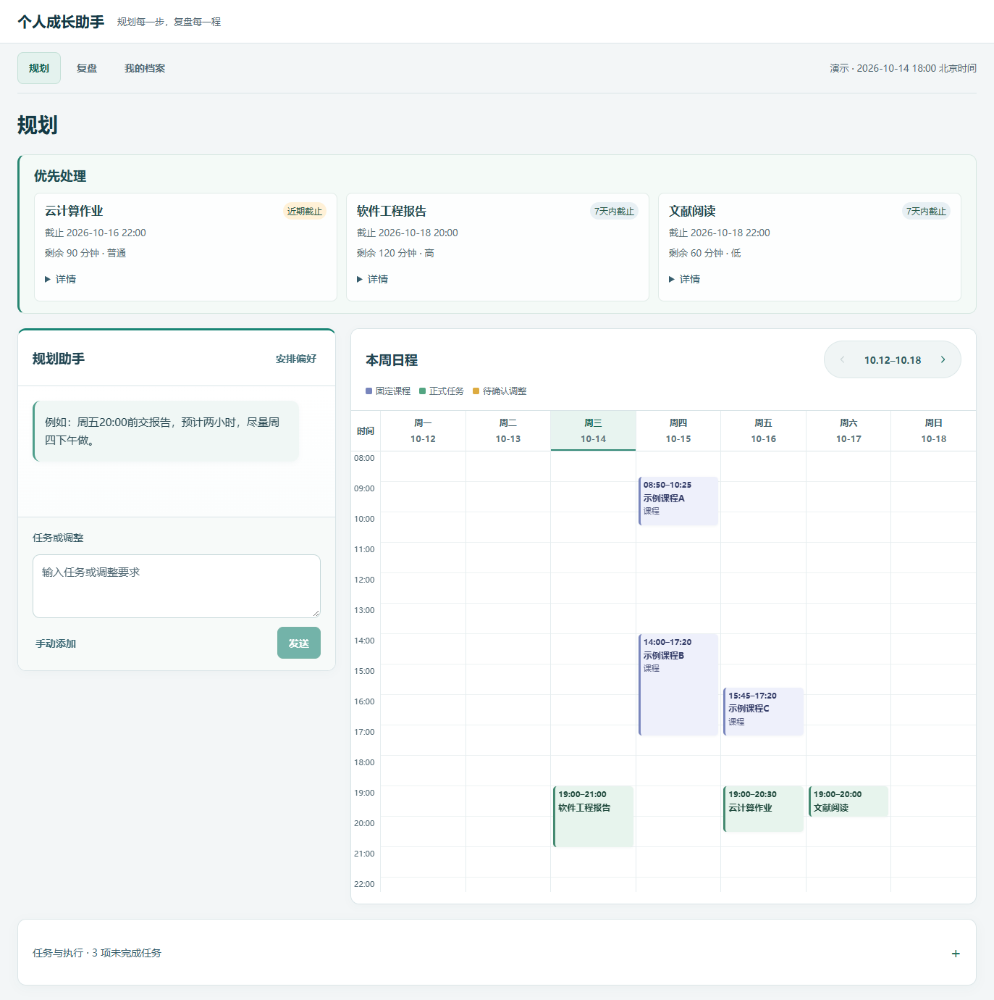

# 个人成长助手 · Student Growth Assistant

软件工程课程项目，使用 **React + Vite + JavaScript、FastAPI + Python、SQLAlchemy + SQLite、Alembic**，提供本地单用户的“规划—执行—复盘—改进”工作台。

- **规划**：两周安排、5 分钟网格、明确允许后分段、候选比较与局部重规划。未受影响的合法安排保持原位；局部失败后，用户明确同意才扩大范围。
- **任务拆解**：AI 或手动生成父子任务草案，编辑、保存并确认后创建。父任务只汇总进度，子任务参与已有排程和执行反馈；无 AI Key 可使用手动拆解。
- **复盘**：记录实际投入、完成/部分完成/暂缓；查看最近 4/8/12 周完成与投入趋势、类别分布、原始估时偏差和目标进展。未知耗时与零值分开显示，日程或计时结束不自动完成任务。
- **我的档案**：管理长期目标、类别、偏好、课程、保护时间和数据备份。

AI 只生成建议和草案。用户确认后，后端重新校验当前时间、DDL、课程、锁定、历史和版本，并在一个事务中保存两周日程；无 AI 配置仍可手动规划和管理数据。



## 环境与安装

使用已有 **Conda app_env（Python 3.11）**，不创建 `.venv`、不重建环境或改动 base。推荐 Node.js 22；现有 Node.js 24 也已通过测试。以下命令从仓库根目录运行：

```powershell
conda env list
conda run -n app_env python --version
conda run -n app_env python -m pip check
# 先检查缺失依赖和冲突；需要安装时使用原版本约束
conda run -n app_env python -m pip install -r backend/requirements.txt -c backend/constraints.txt
npm --prefix frontend ci
# 仅首次配置；不要覆盖已有 .env
if (!(Test-Path backend/.env)) { Copy-Item backend/.env.example backend/.env }
```

可选 AI 配置保存在本地 `backend/.env`：

```dotenv
AI_API_FORMAT=openai
OPENAI_BASE_URL=https://api.deepseek.com/v1
OPENAI_MODEL=填写服务支持的模型名称
OPENAI_API_KEY=填写自己的密钥
AI_TIMEOUT_SECONDS=120
```

也支持 `AI_API_FORMAT=anthropic` 及 `CLAUDE_*` 配置，两组密钥不混用。需要模型的功能在配置缺失时会明确提示；模型请求会发送相关任务与执行事实，不要在业务字段中填写密钥或敏感身份信息。

## 本地运行

打开两个终端，在根目录分别执行：

```powershell
# 终端一
conda run -n app_env --no-capture-output python -m uvicorn app.main:app --app-dir backend --host 127.0.0.1 --port 8000
# 终端二
npm --prefix frontend run dev -- --host 127.0.0.1 --port 5173 --strictPort
```

页面：http://localhost:5173/ ，API 文档：http://127.0.0.1:8000/docs 。正常模式使用真实北京时间和 `backend/data/app.db`，启动时检查 Alembic 版本；显式升级和恢复见 [数据库说明](docs/database.md)。

## 匿名演示

```powershell
& .\scripts\启动演示版.ps1
& .\scripts\停止演示版.ps1
# 新建另一份匿名样例，保留之前的数据库
& .\scripts\启动演示版.ps1 -Reset -OpenBrowser
```

脚本从已有 `app_env` 解析解释器及环境，不硬编码 Conda 安装路径。默认前端 5174、后端 8001；模拟时间为 **2026-10-14 18:00，北京时间**。新数据写到忽略的 `scripts/.runtime/`，不重置正常库或已有本地资料，不停止未知进程。详见 [演示与浏览器验证](docs/demo.md)。

## 测试与审计

```powershell
cd backend
conda run -n app_env python -m pytest -p no:cacheprovider --basetemp=../scripts/.local/pytest
cd ..
npm --prefix frontend test
npm --prefix frontend run build
conda run -n app_env python scripts/publication_audit.py
conda run -n app_env python scripts/check_repository.py
```

测试使用隔离数据库和固定时钟，不自动调用付费模型；测试产物、审计清单和演示日志不进入 Git。安装约束与 npm 锁文件不随整理升级。

GitHub Actions 配置在 `.github/workflows/ci.yml`，PR 和 main 更新时分别运行 Python 3.11 后端全量测试、依赖/文件引用检查，以及 Node.js 22 的 `npm ci`、前端测试和构建。工作流使用 YAML 1.2 的 JSON 子集，可用上述标准库检查命令验证语法与路径；本地通过不代表远程 Runner 已通过。CI 不使用本地 Conda、个人密钥或数据库，压力基准不进入每次 PR。

手动性能基准（纯函数、固定匿名输入、无数据库/AI；每个场景独立子进程，默认110秒超时）与跨阶段 Mock 演示见 [演示文档](docs/demo.md)：

```powershell
conda run -n app_env python scripts/scheduling_benchmark.py --repeats 3 --output scripts/.local/scheduling-benchmark.json
```

## 目录与协作

```text
backend/                 后端应用、正式测试、constraints.txt
  alembic/               冻结迁移基线与版本文件
frontend/                React 页面与正式测试；tests/fixtures 为兼容测试辅助函数
scripts/                 演示、迁移、导入、审计及显式验收工具
  .runtime/、.local/     本地运行和验证产物（忽略）
docs/                    现行架构、API、数据库、演示、协作说明
  images/                原有匿名界面预览
  archive/               少量历史验收记录
```

[现行架构](docs/architecture.md) · [API 契约](docs/api-contract.md) · [小组协作](docs/collaboration.md)

[阶段 0 安全验收](docs/archive/阶段0开发基线与安全验收.md) · [阶段 1 局部重规划验收](docs/archive/阶段1局部重规划与冲突解释验收.md) · [目录整理验收](docs/archive/仓库整理验收.md)

[阶段 2 任务拆解与层级验收](docs/archive/阶段2任务拆解与层级管理验收.md)：仅支持父容器和子任务两级，每个父任务最多 20 项。建议顺序不是强制依赖；草案确认创建任务后，需另行生成并采用日程。数据库 head 为 `0002_task_hierarchy`，JSON 导出升级为 v2，并严格兼容旧 v1 导入。

[阶段 3 成长统计与可视化验收](docs/archive/阶段3成长统计与可视化验收.md)：统计直接读取有效执行反馈与当前正式计划，排除父容器和已撤回反馈，不重复加计时器；无需 AI。缺少可靠历史分母与取消时间日志，因此不显示历史完成率或周取消事件数；只单列全库当前取消状态数。本阶段无数据库结构或依赖变更。

[阶段 4 性能与工程质量验收](docs/archive/阶段4性能与工程质量验收.md)：先测量再复用搜索中的重复评分，保留原策略、预算、候选与独立校验；新增可重复基准、CI、固定测试时钟及跨阶段匿名集成演示。

SQLite、备份、`.env`、个人课表、日志和临时截图只保留本地。历史验收中的路径与结果对应当时版本，当前操作以本 README 为准。

项目保留原小组仓库 [oliver-szr/student-growth-assistant](https://github.com/oliver-szr/student-growth-assistant) 的提交历史与作者贡献。本次未新增许可证；仓库公开不等于授予额外使用、修改或分发许可。
