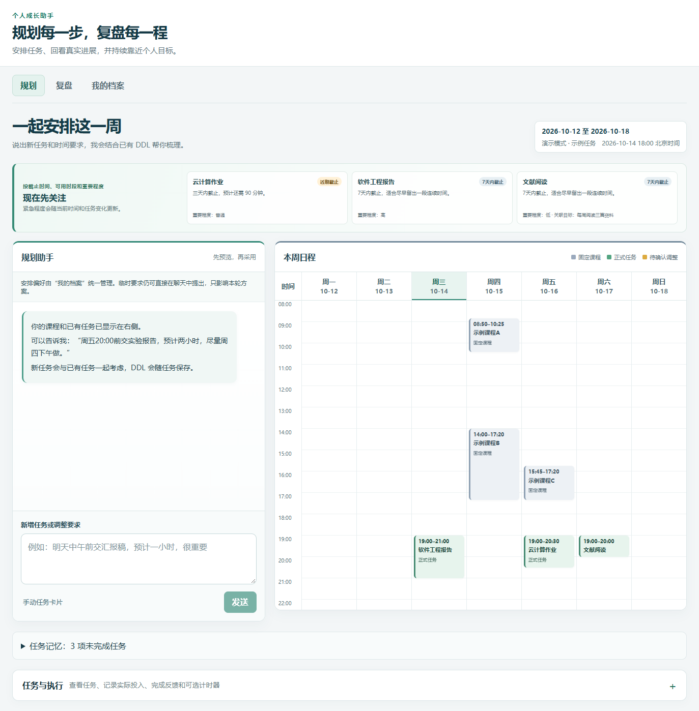
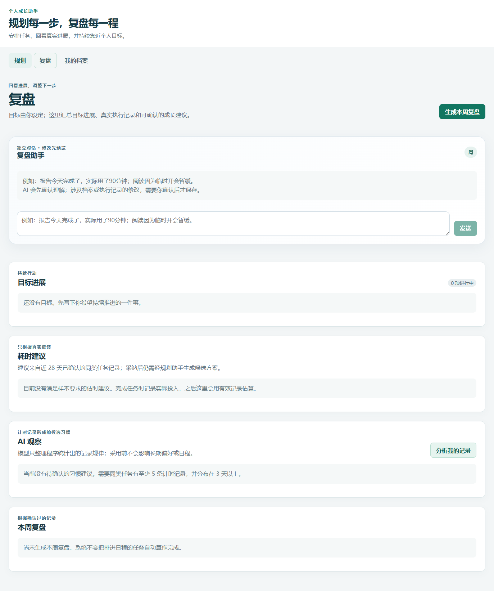
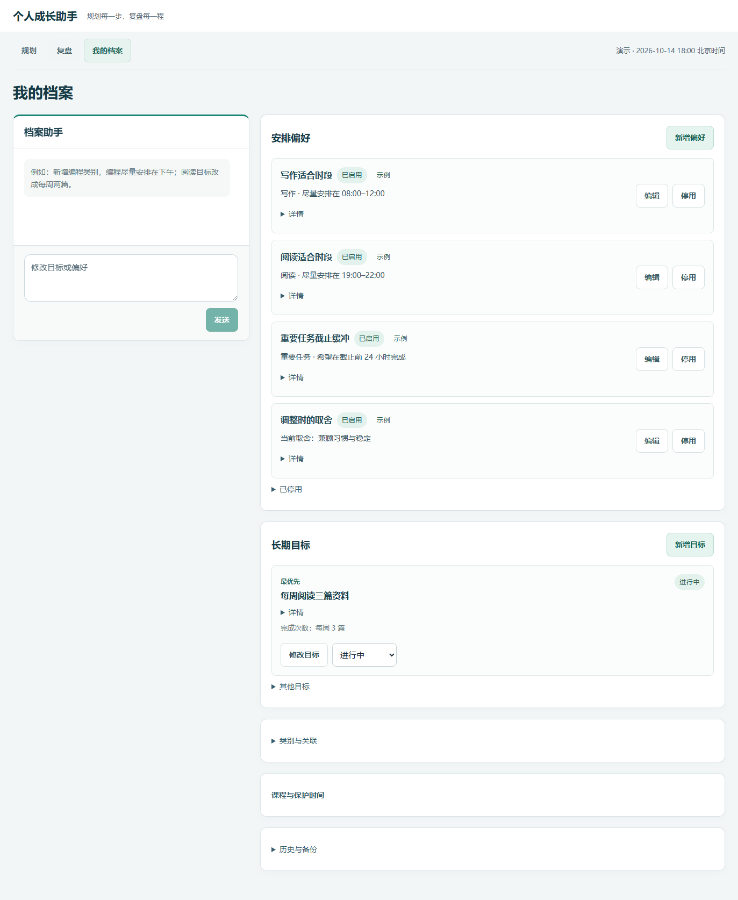

# 个人成长助手 · Student Growth Assistant

当前发布版本：[v1](https://github.com/szt1107/student-growth-assistant/releases/tag/v1)。

通过 AI 对话整理任务、目标和偏好，根据真实执行记录改善下一次安排。本项目是 **本地单用户课程项目 MVP**，使用 React、FastAPI 和 SQLite。

## 三个工作台

| 页面 | 可以做什么 |
|---|---|
| **规划** | 输入新任务、DDL 和临时要求；查看冲突、比较候选安排，确认后保存日程 |
| **复盘** | 补录或更正完成情况、实际耗时和阻碍；查看目标进展、估时建议和周复盘 |
| **我的档案** | 对话整理长期目标、自定义类别与安排偏好；管理课程、固定时间与数据备份 |

**AI 理解表达 → 程序计算与校验 → 展示修改草案 → 用户确认保存。** AI 不直接修改正式日程。课程、锁定时段、截止时间和当前时间由后端检查，旧候选不能覆盖新数据。

## 页面预览





截图使用匿名演示数据，不代表真实个人经历。

## 安装

推荐 Python **3.11**、Node.js **22**、Git；依赖版本通过 `codex/requirements.lock.txt` 固定。当前开发复用已有 Conda 环境 **app_env**，不创建 `.venv`，不修改 base。Node.js 24 已通过本阶段测试和构建，无需更换版本。Windows 下建议使用较短的项目路径，避免 SQLite 备份超过系统路径限制。下列命令在项目根目录运行，示例使用 Windows PowerShell：

```powershell
git clone https://github.com/szt1107/student-growth-assistant.git
cd student-growth-assistant
conda env list
conda run -n app_env python --version
conda run -n app_env python -m pip check
# 先核对现有版本；可加 --dry-run 检查安装计划，冲突时先诊断
conda run -n app_env python -m pip install -r backend/requirements.txt -c codex/requirements.lock.txt
conda run -n app_env python -m pip check
npm --prefix frontend ci
Copy-Item backend/.env.example backend/.env
```

所有后端安装、开发和测试使用 `conda run -n app_env`；不要删除或重建已有环境。上述 Conda 命令也适用于 macOS/Linux，前后端可以分别手动启动。

## 配置 AI

在本地 `backend/.env` 填写以下配置，文件已被 Git 忽略：

```dotenv
AI_API_FORMAT=openai
OPENAI_BASE_URL=https://api.deepseek.com/v1
OPENAI_MODEL=填写账号可用的模型名称
OPENAI_API_KEY=填写你自己的密钥
AI_TIMEOUT_SECONDS=120
```

支持 OpenAI Chat Completions 兼容接口，以及 `AI_API_FORMAT=anthropic` 对应的 Anthropic Messages 兼容接口。分别读取 `OPENAI_*` 或 `CLAUDE_*` 配置，不借用另一组密钥。`claude_client.py` 名称仅用于兼容。

没有有效配置也能启动并管理任务、目标、课程和执行记录；需要模型的聊天、分析和解释会提示不可用。单次模型调用最多 120 秒，可取消或重试。模型可用性和输出质量依赖配置的服务。

## 正常启动

打开两个终端，均从项目根目录运行：

```powershell
# 终端一：后端
conda run -n app_env --no-capture-output python -m uvicorn app.main:app --app-dir backend --host 127.0.0.1 --port 8000
# 终端二：前端
npm --prefix frontend run dev -- --host 127.0.0.1 --port 5173 --strictPort
```

访问 **http://localhost:5173/**，API 文档为 http://127.0.0.1:8000/docs 。正常模式使用真实北京时间，数据库默认是 `backend/data/app.db`。

## 匿名演示

```powershell
& .\codex\启动演示版.ps1 -OpenBrowser
# 停止演示；正常数据不受影响
& .\codex\停止演示版.ps1
# 重新生成匿名样例
& .\codex\启动演示版.ps1 -Reset -OpenBrowser
```

演示地址为 **http://localhost:5174/**，后端端口为 8001。场景固定为 **2026-10-12 至 2026-10-18**，模拟时间是 **10 月 14 日 18:00，北京时间**。课程、任务、偏好和学习样本均为示例。

默认不会读取个人课表。如需使用自己的课程，显式添加 `-CourseSource <本地课程JSON路径>`；新场景可使用 `-Reset`。演示数据库独立保存在 `codex/.runtime/`，不会重置正常数据库。脚本不停止未知进程。

## 数据与使用边界

- 目标、偏好、对话、反馈和日程保存在本地 SQLite；“我的档案”提供导出与恢复。
- 备份不包含 API 密钥。导入校验结构和引用，失败回滚；恢复后旧运行和候选失效。
- 使用真实 AI 时，相关任务、目标、偏好和执行事实会发送给所配置的模型服务；不要在业务字段中填写密钥或敏感身份信息。
- 安排范围是本周剩余时间及下周，按 5 分钟网格计算；默认连续完成，明确允许后可分段。界面可切换本周／下周，采用时统一保存两周计划。
- 已结束但没有完成反馈的任务先核对剩余工作；跨周沿用同一任务，不自动修改外部 DDL。未提供多人账号、公网部署或外部日历同步。
- 软偏好不能覆盖课程、保护时间、锁定和 DDL。有限搜索未找到方案不代表数学上无解。
- 耗时与习惯建议需要有效执行样本，用户采用后才生效；日程或计时结束不会自动证明任务完成。

## 验证

```powershell
cd backend
conda run -n app_env python -m pytest -p no:cacheprovider --basetemp=../codex/.local/pytest-public
cd ..
npm --prefix frontend test
npm --prefix frontend run build
conda run -n app_env python codex/publication_audit.py
```

测试使用独立数据库。实际发布结果见 [发布验收报告](codex/公开发布验收.md)。历史阶段文档保留原阶段上下文，不代表当前版本的全部验收已经通过。

## 进一步了解

[仓库目录](DIRECTORY_STRUCTURE.md) · [现行架构](docs/architecture.md) · [使用说明与演示讲稿](codex/公开版使用与演示.md)

本轮升级见 [修改与验收说明](codex/本轮修改与验收.md)，已有数据库升级见 [迁移与恢复说明](codex/数据库迁移与恢复.md)。启动会检查 Alembic 版本，实际升级前先生成本地备份；也可运行 `conda run -n app_env python codex/migrate.py` 单独迁移。

阶段 0 安全修复保留旧单周 `/api/plans` 接口，阻止过去时间的新安排，并在确认时重新检查约束。旧接口无法安全处理的分段、锁定及已开始记录会明确拒绝，使用现有规划工作台处理；已有正式计划不会因拒绝而改变。详见 [API 契约](docs/api-contract.md) 和 [阶段 0 验收记录](codex/阶段0开发基线与安全验收.md)。

最新整理包含三页统一的聊天／结果布局、精简文字、手机切换、可访问的日程详情，以及冲突提示与确认联动修复。更新验证见 [最新版上传验收](codex/最新版上传验收.md)。公开预览使用匿名样例；个人课程、数据库和私人演示图片保留本地。

## 小组来源与许可

本项目基于小组课程作业 [oliver-szr/student-growth-assistant](https://github.com/oliver-szr/student-growth-assistant) 持续完善，保留原提交历史与作者贡献。此仓库是个人整理展示版本，不代表原小组仓库已同步升级。

**本次没有新增开源许可证。** 公开可见不等于授予额外使用、修改或分发许可，后续许可由共同作者协商确定。
