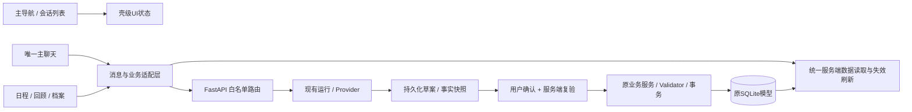

# Student Growth Assistant V2：架构建议与阶段 1 准备

日期：2026-10-21。基线 `5f953c91722408b484608e06c69280f9826e0080`，审计依据及实测见[阶段0审计](v2-stage0-audit.md)。全文为设计建议，**本轮不新增模型、迁移、API、依赖或业务组件**。未找到完整《v2产品框架设计.md》，未完成逐条对照。

## 1. 演进原则与边界

保留 React/Vite/JavaScript、FastAPI、SQLite/SQLAlchemy/Alembic、现有Provider。保留任务ID、有效反馈事实、任务树、两周5分钟排程、独立Validator、局部范围授权、source_revision及原子确认。日历展示支持更长范围，不改变引擎规划上限；普通聊天允许只生成回复，不产生任务、复盘或长期记忆。

AI只理解、查询和提出草案。后端从白名单动作构建草案；正式变更必须由用户点击明确的保存/采用按钮，后端校验归属、版本、当前时间、约束后事务提交。模型不能直接发SQL、写PlanItem、确认操作或授予扩大重规划范围的权限。直接手动表单的“保存”仍是用户明确操作，不必全部强制经过AI。



消息是交流/引用记录，正式Task/Plan/Feedback/Goal仍是业务事实源；不能把聊天文本解析成另一份永久正式任务库。

## 2. 日历选型

### 2.1 比较与决定

| 维度 | FullCalendar React 标准插件 | React Big Calendar | 扩展现有自定义Calendar |
|---|---|---|---|
| React/Vite | React适配包支持React19；保留Vite，无需Next | peer声明支持React19；需选择localizer及日期库 | 已在当前React/Vite运行 |
| 日/周 | timeGridDay/timeGridWeek | 内置day/week/work_week | 当前只有两周中选一周，固定08–22；需拆分并开发日视图 |
| 月/年 | dayGridMonth、multimonth插件multiMonthYear；年为多月格，不是全年小时网格 | 内置month；无内置year，需自定义年视图 | 月格、12月概览、跨月边界均需自行开发 |
| 时间轴/任务/课程 | 标准纵向时间网格可满足个人日程；资源横向timeline另属Premium | 日/周时间槽、resource分组、agenda可用 | 现有绝对定位任务块，可复用配色/数据规则；重叠/短块布局负担大 |
| 点击/选择/后续拖拽 | interaction标准插件支持选择、拖拽、resize；可先只读 | 点击/选择内置，拖拽使用addon | 已有点击dialog；选择、键盘操作、拖拽、触摸需自行实现 |
| 数据适配 | EventInput + extendedProps承载ref/plan/draft/segment；边界清晰 | accessor转换现有数据；Date/localizer时区需谨慎 | 当前visibleSchedule等纯函数可复用；渲染与规划data耦合需拆开 |
| 样式 | 变量、eventContent和类名；避免深层DOM选择器，抽主题层 | CSS/Sass/components覆盖；重度样式也有维护成本 | 最自由，但所有可访问性和布局测试自己维护 |
| 维护成本 | 首次适配中等，四视图长期成本较低 | 首次中等，年视图/时区补充成本中高 | 周视图短期最少改动；全套四视图长期最高 |
| 许可证/费用 | 标准core/react/daygrid/timegrid/interaction/multimonth为MIT；资源时间线不得假定MIT，另核Premium许可 | MIT | 仓库未新增许可证；当前代码的团队授权仍需保留 |

**建议：1A保留现有周日历；后续日历阶段采用 FullCalendar 标准插件，先只读周视图，再日/月/多月年。** 这是在四视图真实要求下减少自行实现范围的选择，不是阶段0安装决定。React Big Calendar为备选；如后续确认只需周视图，可继续使用旧Calendar。不会为了接入日历更换排程引擎。

“参考Notion Calendar的时间轴”在本产品解释为日期横排、钟点纵轴、事件块、当前时间指示及独立滚动，不自动扩大为多人/资源横轴timeline。若以后明确要求资源排程，先重新评估授权和需求，不能暗中引入Premium。

### 2.2 当前上游核查与限制

2026-10-21直接读取上游文件及npm发布元数据；文档站fullcalendar.io和assistant-ui.com返回403，搜索工具未返回可用内容，改核官方GitHub原始文件。以下是本轮核实的候选版本/源码，**不是宣称它们都是最新发布版，也不是本机集成通过**：

- FullCalendar React **6.1.21**：React/ReactDOM peer `^16.7.0 || ^17 || ^18 || ^19`、MIT，见[适配包](https://github.com/fullcalendar/fullcalendar-react/blob/v6.1.21/package.json)、[标准许可证](https://github.com/fullcalendar/fullcalendar/blob/v6.1.21/LICENSE.md)。
- [multimonth 6.1.21源码](https://github.com/fullcalendar/fullcalendar/blob/v6.1.21/packages/multimonth/src/index.ts)包含multiMonthYear；[发布元数据](https://registry.npmjs.org/@fullcalendar/multimonth/6.1.21)为MIT。[timegrid](https://github.com/fullcalendar/fullcalendar/blob/v6.1.21/packages/timegrid/src/index.ts)和[interaction](https://github.com/fullcalendar/fullcalendar/blob/v6.1.21/packages/interaction/src/index.ts)核实日周及交互能力。
- [resource-timeline发布元数据](https://registry.npmjs.org/@fullcalendar/resource-timeline/latest)本轮返回6.1.22，license=`SEE LICENSE IN LICENSE.md`，不是MIT。随后只在内存读取该官方发布包的LICENSE.md，确认其列出三选一：付费Commercial、CC BY-NC-ND 4.0（试用/非商业）、GPLv3（开源项目）。商业条款站点全文仍受403限制，未给出价格或课程项目自动免费资格承诺；现仓库未声明GPL，不应直接假定可选GPL路径。选定方案不依赖该包。
- React Big Calendar仓库package为**1.20.0**，peer包含React19、MIT；[package](https://github.com/jquense/react-big-calendar/blob/master/package.json)、[LICENSE](https://github.com/jquense/react-big-calendar/blob/master/LICENSE)、[Calendar内置视图](https://github.com/jquense/react-big-calendar/blob/master/src/Calendar.js)已核对。

后续依赖引入必须锁定同系列精确兼容版本，核验实际发布包许可证及所有转依赖，完成独立的Vite构建、上海时区/事件布局/键盘/触摸验证。阶段0未修改package或锁文件。

### 2.3 数据适配契约（建议）

新增纯适配器，例如 `features/calendar/calendarAdapter.js`。输入是服务端正式事件与独立候选，输出只供渲染的event，不可作为写入事实：

```text
id = formal:{plan_item_id} / course:{rule_id}:{occurrence_date}
     / draft:{draft_id}:{version}:{task_ref}:{segment_index}
start/end = 带偏移时间戳，end为不含边界
extendedProps = kind, taskId/ruleId, planId, draftId, version,
                segmentIndex, status, locked, sourceRevision
```

旧Assistant正式片段暂时没有plan_item_id可见时，用ref+start_at+end_at生成稳定展示键，不伪造数据库ID。多段task有多个event，但只有一项任务；课程live occurrence与PlanItem课程快照要按明确展示规则去重：默认展示当前启用规则的课程，历史快照只在“当时计划”中看，不能混为同一真实历史。

保留 `visibleSchedule` 对候选新增/移动/保留/移除的语义，必要时提取而不是另写不同算法。日期范围换页只GET，不创建新会话/候选、不bump revision。首次集成 `editable=false`；未来拖拽先revert视觉移动，再形成带源版本的待确认草案，不能直接PATCH正式时间。课程移动与任务重规划是不同动作。

时区固定Asia/Shanghai，浏览器系统时区不能决定业务日期。FullCalendar named timezone的精确offset行为必须选受支持时区适配器或显式的上海日期转换策略并测试；不能把UTC coercion下的本地getters当正确。API的上海自然日边界换UTC；跨天任务数据要裁剪显示但保留原始ID与分钟，不静默修改。

## 3. 聊天技术方案

| 方案 | 收益 | 与现有后端的适配成本/边界 | 决策 |
|---|---|---|---|
| 复用ChatMessages、SafeMessage、现有composer/run状态 | 低依赖，已有中文错误/跟随阅读/安全文本和取消重试行为 | 需合并两个轮询实现、提取控制器、增加卡片渲染/分页/会话切换；不会自动获得自由聊 | **优先采用** |
| assistant-ui | 现成聊天交互和可扩展runtime，可接受自有store/backend | 用ExternalStoreRuntime适配messages/onNew/onCancel和thread选择；现有202轮询非SSE，草案确认也非SDK直接tool执行，需转换；依赖/样式增加 | 后续原型测出收益后再决定；不作为1A前提 |
| 借鉴其他开源聊天UI组织 | 会话列表、composer、message renderer的职责划分可借鉴 | 通用LLM模板通常没有本项目revision/事务/草案语义；复制整套会引入无关SDK/部署模式 | 仅借鉴结构，自行实现本项目边界；复制源码前单独核许可证 |

assistant-ui上游本轮核实：[MIT许可证](https://github.com/assistant-ui/assistant-ui/blob/main/LICENSE)、[React包](https://github.com/assistant-ui/assistant-ui/blob/main/packages/react/package.json)为0.15.30、React18/19；[ExternalStoreRuntime官方源码文档](https://github.com/assistant-ui/assistant-ui/blob/main/apps/docs/content/docs/runtimes/custom/external-store.mdx)明确可桥接现有状态与持久化。不是必须使用Next.js，其示例的`use client`不构成本项目迁移理由；自托管开源UI也不等于所有云服务免费。没有引入assistant-ui、AI SDK或更换Provider。

建议将现有运行控制抽成 `useAssistantRun`：按sessionId/runId索引，统一终态、取消、人工重试、有限轮询和卸载清理。切会话只停止观察，不默默取消后端；迟到响应写回所属session缓存，不能覆盖当前会话。写请求超时先GET同一request/run/draft状态，不自动换幂等ID重发。保留失败输入，不自动确认。

后续统一聊天的服务端回复建议分型：纯reply、查询结果、needs_input、业务draft、操作receipt。路由器按白名单工具分派；无业务意图时走自由回复，operations为空，不能强迫任务/记忆。消息content使用版本化envelope，未知kind旧客户端可安全显示text；禁止模型返回任意URL作为自动导航或任意组件名执行。

## 4. 前端组件和状态设计

### 4.1 建议结构

```text
App（保留Legacy入口与切换开关）
└─ V2WorkspaceShell
   ├─ PrimaryNav                 首页/日程/复盘/档案
   ├─ ConversationSidebar        可收起，会话与搜索
   ├─ MainChat
   │  ├─ ConversationHeader
   │  ├─ ChatMessages + SafeMessage
   │  ├─ BusinessCardRenderer    只读引用/进入工作区/明确确认
   │  └─ ChatComposer + RunStatus
   └─ WorkspacePanel            collapsed / normal / expanded
      ├─ ScheduleWorkspace      CalendarAdapter + Tasks/Feedback编辑器
      ├─ ReviewWorkspace        回顾(日/周/月) / 复盘记录
      └─ ProfileWorkspace       目标 / 时间课程 / 偏好 / 记忆 / 数据管理
```

目录建议 `components/workspace/` 放壳，`features/chat/`、`features/calendar/` 放适配层，`state/` 放reducer/context与请求控制。原pages先用适配器逐项接入，不一次搬迁所有文件。`TaskForm`、`TaskHierarchy`、`TaskBreakdown`、`ScopedChanges`、`TimeRuleForm`、`NaturalLanguageTimeRule`、统计纯函数/图表和api wrappers可复用；原页面内置聊天要从工作区正文分离，防止四区壳里再嵌套双列聊天。

### 4.2 状态归属

| 状态 | 唯一归属 | 持久化/恢复建议 |
|---|---|---|
| 当前会话 | Workspace UI reducer.activeConversationId | 本地按workspace_id（将来userId）保存ID；服务端校验后恢复；404回列表，不创建替代假会话 |
| 当前主导航/工作区/二级页 | 同一UI reducer | page、reviewTab、profileTab与workspaceMode分离；首页选日程不应重建session |
| 日历日期/视图/滚动 | calendar UI state | selectedDate、view、scrollTime；进入展开只改宽度；“今天”才显式改日期 |
| 未提交表单 | EditBuffer registry | 按实体类型+ID+会话/工作区归属+baseVersion索引，dirty/error保留；安全本地缓存可用sessionStorage，刷新恢复前校验服务器版本 |
| 当前业务草案 | 服务端draft资源的缓存；UI只持activeDraftRef | 按type/id/version/status索引，两边引用同一对象；未保存编辑存在同一EditBuffer |
| 正式任务/日程/反馈/目标 | 服务端事实，经统一read cache读取 | 本地缓存只读快照；成功写入用receipt失效对应query，不手工维护两份独立正式数组 |
| 消息与业务关联 | 服务端消息引用；渲染时查资源状态 | 历史显示生成时摘要，操作能力看当前status/version，不从旧text恢复按钮权限 |
| 运行/加载/错误 | 按sessionId/runId隔离的request controller | 组件切换不重发write；generation token阻止旧查询覆盖新查询 |

1A使用React Context+useReducer，无需安装状态库。1B集中封装现有请求层与按key缓存/刷新；若后续并发查询和失效关系复杂，再评估TanStack Query，届时它是唯一server cache，不能与手写全量store各管一份事实。URL只存可分享的页面/日期，不能把表单私人文本、AI输入或token放query。

本地草稿≠服务器草案≠正式数据。临时编辑跨工作区切换保留，不意味着自动提交；后端草案保存成功才更新version。离线缓存不覆盖服务端。恢复数据库或切用户时清空旧正式缓存、使旧草案失效，编辑缓存隔离并提示导出/放弃；禁止复用旧workspace_id下的输入。

聊天/工作区双向同步流程：

1. chat工具调用或工作区编辑定位同一draftRef，显示同一版本；本地未保存更改标dirty。
2. 服务端PATCH带expected_version；成功后更新单一draft缓存，消息卡片只显示“已更新”及引用，不再保存可编辑副本。
3. 另一端修改导致409时保留本地编辑，读取新版本并让用户比较/重建，不静默覆盖。
4. 确认前等待保存结束，以服务器最新version和source_revision确认；成功receipt刷新任务、日程、统计、目标及相关draft。
5. 失败/超时保持待确认；未知结果按原幂等标识查询，禁止以UI乐观状态宣布已保存。

## 5. 后端与数据库演进（仅设计）

### 5.1 优先扩展 AssistantSession / AssistantMessage

默认推荐扩展既有模型并在新API使用Conversation/Message产品命名，**不另建一套复制消息正文的会话数据库**。建议后续新增 nullable title、updated_at、pinned_at、archived_at及归属字段；独立聊天不受week_start限制，业务操作在tool context携带planning_week/period。保留旧scope与week_start供旧API，若未来让week_start可空，需要SQLite约束变更和旧客户端测试，不在阶段0动冻结migration。

历史profile哨兵周保留原值，迁移标记其legacy_scope，不解释成1970年的真实聊天。历史planning会话保持旧确认规则；从旧消息继续当前业务应建立新的当前周tool context和新草案，不能解除require_current直接确认历史proposal。

消息建议补created_at、schema_version及稳定排序/游标；旧消息无精确时间不能按created_at伪造真实发生时刻，可保留null或明确来源为迁移推定，仍按id排序。新会话按updated_at/id排序，消息cursor按稳定ID分页。归档不删除业务事实；删除会话先软删并处理pending草案，running操作须明确取消或拒绝，正式任务/反馈不能级联消失。保留期与最终删除策略待产品确认，不自行规定永久保留。

### 5.2 草案与工具关联

保留AssistantProposal和GrowthChangeDraft；拆解payload已有version，不重复建TaskDraft。增加类型化引用层/统一只读envelope，例如 `{type,id,version,status,source_revision,origin_message_id}`，避免新增一个包揽所有业务的无约束JSON表。

profile/review的GrowthChangeDraft目前preview没有expected编辑version；planning preview用新proposal和latest关系，应先说明语义，再按业务类型补version/冲突控制。source_revision解决正式资料变化，draft version解决草案本身的并发修改，二者不能相互替代。

消息引用可先使用版本化content，再在需要完整外键约束/多引用查询时增加MessageBusinessLink（conversation/message、type、resourceId、version）。任何多态ID必须由后端校验资源类型、存在和归属；客户端卡片不能凭ID读取其他用户数据。

确认继续调用原事务服务。Assistant重复已applied返回原结果；拆解返回原created_task_ids；旧plans重复confirm仍409。新统一工具确认可以适配这些差异，但不得修改旧契约让旧客户端误判。新建操作以用户/会话+client_request_id唯一，并校验同key不同payload；保存操作receipt以便重试查询。扩大范围必须由独立显式操作传递授权记录。

### 5.3 建议新接口，不是已实现API

| 建议接口 | 目的 / 兼容策略 |
|---|---|
| GET/POST `/api/conversations`；PATCH/DELETE `/{id}` | 有界列表、关键词查询、置顶归档/软删除；返回独立会话元数据，旧sessions不删除 |
| GET `/api/conversations/{id}/messages?cursor&limit` | 稳定分页+消息引用；旧全量GET继续兼容，不据此要求前端加载所有历史 |
| POST `/api/conversations/{id}/runs` | 纯聊/查询/业务草案路由；复用run/Provider生命周期，新增上下文权限边界 |
| GET `/api/calendar/events?start&end&timezone=Asia/Shanghai` | 有界范围只读正式安排+周期课程，end不含；不触发排程/写入 |
| GET `/api/reviews/facts?period=day|week|month&start=...` | 指定自然周期的只读事实、as_of/口径版本；独立于4/8/12周趋势 |
| POST/PATCH/confirm `/api/review-drafts/...`；GET `/api/review-records` | 先生成/编辑草案再确认保存记录；历史周复盘继续可读，不能迁移为“用户确认过” |

calendar范围建议每请求最多约一年（含边界补日，确切上限后续定），年视图可按月/季度分批读取并分页/限条；错误区分“加载失败”“该区间无正式任务”“周期规则有效性未限定”。查询confirmed PlanItem与区间相交 `start_at < end AND end_at > start`，不只按week_start过滤，避免跨周漏项。读取时在一致快照合并，响应revision/as_of及按来源标记，不把当前Task状态改写成过去Plan快照。

周期规则先复用expand_time_rules逐周有界展开；无学期范围的weekly在API中标明“按当前规则展开”，不捏造停课/节假日。任务deadline另作可选提示，不能冒充已安排时段。未排程任务留任务列表；旧/新草案由单独请求overlay，禁止混入正式events。

### 5.4 回顾、记录与长期记忆

复用growth_statistics与growth_tracking的有效反馈、完成去重、耗时未知规则；日/月查询要抽出共享范围聚合，**不能复制一套不同口径**。保留周复盘facts作为生成时快照；当前统计是查询时有效事实，两者明确标日期/as_of和更正影响。

复盘记录建议使用GrowthChangeDraft的review_record子类型，确认后保存ReviewRecord（或评估扩展GrowthWeeklyReview）：period_kind、start/end、timezone、facts_snapshot、facts_schema_version、as_of、用户结论/下一步、source_conversation/message、confirmed_at。旧GrowthWeeklyReview没有“用户确认”的证据，标legacy_generated而非自动补confirmed_at；是否独立表取决于对旧周API兼容成本的专项评估。结论内容与未来任务创建分开确认，避免一键保存复盘同时改日程。

正式偏好、目标、课程仍在原业务表。通用记忆后续新增MemoryEntry（建议字段：来源引用、用户确认状态、版本、适用范围、更新/失效时间、删除标记）；检索只读已确认且未失效记录，草案不检索为事实。先做可管理列表和确定性筛选，再决定向量检索；不因聊天就自动长期保存，不把完整聊天记录永久灌入上下文。删除/编辑记忆不自动删除目标、反馈或课程。

### 5.5 多用户与数据兼容

当前没有认证/用户表；PlanningState(id=1)、GrowthUserProfile、AssistantPreference、WorkspaceMetadata、全局计时唯一约束等均是单用户设计。后续以server-resolved user/workspace上下文隔离，不能信任请求体user_id。Task/TimeRule/Plan/Session/Run/Draft/Feedback/Goal/Review/Memory及关联查询都要检查归属；singleton改每workspace一份，唯一索引/idempotency/confirmed-per-week也按owner重建。跨owner父子/草案/目标引用必须拒绝。

可以先将本地旧数据映射到明确的legacy本地owner，新增列先nullable/回填/验证，再收紧；不得猜多个真实用户并分配私人数据。身份、多用户后台worker上下文、导出/恢复授权及端到端越权测试完成前，保持仅本机单用户，不对公网部署。

新增数据库字段/表需要新Alembic revision；不改0001/0002或冻结baseline_models。SQLite表重建、FK/索引验证、未知结构拒绝、重复升级与备份都需测试。growth_data现按Base.metadata严格导出/校验26表和全部列，任何模型扩展都需新JSON格式版本与显式v1/v2转换；不能用当前模型假装旧v2 schema，也不能让旧JSON恢复静默清空新表。

保留一个冻结的v2导出契约用于后续转换，纳入匿名真实fixture。恢复仍整事务、提高revision、让所有pending草案stale、running变interrupted；随后刷新会话和UI缓存。升级前独立备份不得只依赖5份轮换；回退数据库用匹配旧应用的备份，不用破坏性downgrade删列。

## 6. 阶段 1 可执行方案（尚未开始）

### 6.1 1A：布局与状态骨架

前提：用户审核阶段0；再次检查Git干净/基线/测试资产，确认是否取得完整产品文档；不对个人数据库做演示验证。

建议先改 `frontend/src/App.jsx`、`frontend/src/styles.css`（或新增局部workspace样式），新增 `components/workspace/V2WorkspaceShell.jsx`、`PrimaryNav.jsx`、`ConversationSidebar.jsx`、`WorkspacePanel.jsx`，新增 `state/WorkspaceContext.jsx`、`workspaceReducer.js`、编辑缓存hook。`main.jsx`只在需要Provider包裹时最小改动；保留原页面入口和显式开发切换开关。

1. 先建立四区和收起/普通/展开三种模式，移动端单视面切换；会话列表暂无API时展示真实的能力限制，不能用假会话承诺已持久化管理。
2. 将页面选择、日期/视图、会话ID、文本输入和未提交编辑提升为可控状态。先不拆排程服务、不新增会话schema、不安装日历/聊天库。
3. 用已有SafeMessage/ChatMessages作为中心容器；未接入业务的入口明确不可操作。保留旧业务入口用于功能回归，旧页不直接嵌套成第二套聊天。
4. 为真实的切换、刷新恢复、异步迟到、键盘焦点增加行为测试；现有node --test主要是纯函数/SSR/源码契约，不能冒充完整DOM交互。浏览器验收仅连接新匿名库，是否引入DOM测试依赖另行评估并锁版本。

验收：1440/1280桌面与约390手机结构可用；首页聊天为主、右侧今日，展开周日历获得主要空间；切导航/收起/展开不清日期和输入；编辑缓存按资源隔离；键盘可到各区、隐藏区不获焦点；旧入口核心行为和89项前端/后端全套回归及构建通过。断点是建议验证尺寸，非冻结产品规定。没有伪造session列表/日月年业务已实现。

回退：一个独立布局提交，开发开关回到原App入口；本阶段不改schema或业务API，回退不需要恢复数据库。保留匿名库证据，不改用户库。

### 6.2 1B：在旧契约下渐进接入

建议顺序：

1. 提取 `AssistantPage.jsx` 中Calendar、候选/策略/ScopedChanges及run控制器，先保持原数据契约；把中央聊天和右侧日程正文分别交给新壳，不能并行挂载两个run发送器。
2. 复用 `api.js`，集中 `useAssistantRun` 和查询/失效策略；按session隔离数据及abort/generation token。统一任务确认后刷新、保留request幂等键；不改后端confirm语义。
3. 接入 `TasksPage` 的TaskForm/TaskHierarchy/反馈计时，与TaskBreakdown编辑缓存；正式保存后重新读取原聚合API，检查父容器不能执行、历史/锁定不动、stale禁确认。
4. 将 `GoalsGrowthPage.jsx`、`MyProfilePage.jsx` 的正文从WorkspaceChat分离成可复用工作区组件，保留旧包装页面作回退。中心暂支持显式旧scope模式并标注范围；切工作区本身不默默换对话/运行意图。
5. 先把现有周日历经CalendarAdapter接入。FullCalendar安装/四视图/范围API放独立后续提交（2B），与布局分开评审；长期统一会话及业务卡片需要2A API后才接通。

建议主要文件：`pages/AssistantPage.jsx`、`pages/TasksPage.jsx`、`pages/GoalsGrowthPage.jsx`、`pages/MyProfilePage.jsx`、`components/WorkspaceChat.jsx`、`components/WorkbenchLayout.jsx`、`api.js`，以及新增chat/calendar适配器；TaskBreakdown/TaskForm只为受控状态最小适配。后端原则上保持原路由/服务；不能为让UI看起来统一直接放宽scope、require_current或revision检查。

新增测试覆盖：两个面板编辑同一draft、保存失败保留输入、409版本冲突、确认响应丢失后原ID查询/幂等、切会话期间返回/取消、重复点击不双发、恢复JSON后旧草案禁用、周切换/上海午夜、分段事件去重、跨页计时与反馈状态刷新。后端已有确认原子性/局部范围/旧API差异测试继续全量执行；新适配若不改后端，不编写仅镜像实现的重复测试。

验收：匿名Mock链路“创建目标→拆解审核→确认父子任务→局部排程/冲突→用户采用→记录耗时→统计/目标刷新”能在新壳完成；放弃/过期/无Key/取消/重试不写错误正式数据；列表/聊天/工作区不各持可变正式副本；旧scope恢复和已有数据导出读取仍正确。**不得把该验收记作完整自由聊天、会话管理、日/月/年回顾或长期记忆完成。**

回退：按日程、执行、复盘、档案分别提交适配，旧包装和开关保留到新壳验收；如果未来某提交涉及schema，单独先备份、保留旧程序读兼容期，并按迁移预案恢复，不能仅切Git标签。

### 6.3 后续门槛

2A先冻结会话/消息/工具引用/草案版本契约与兼容导入方案；2B先冻结范围读取和自然日/月事实口径再安装日历；3再实现可管理记忆；4在任何公网部署前完成身份隔离。若完整产品文档到位与摘要冲突，先记录差异并更新设计，不把本建议当成未经审核的已确认需求。

**本轮到此停止，不执行1A、1B或其他后续阶段。**
