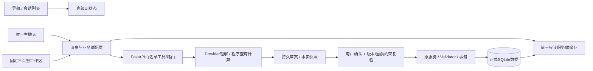

# Student Growth Assistant V2 开发主文档

更新日期：2026-10-22。本文合并阶段0审计、架构建议与关键结构原型，后续V2开发直接更新本文，不再按阶段新增报告。
产品规则以[《v2产品框架设计》](../v2产品框架设计.md)（2026-10-20版）为准；已完整对照其第1–14节及核心验收清单。产品原文独立保留，本文只记录技术约束、证据和实施边界。
2026-10-21用户最终确认交互修订：左导航提供中央完整功能，右侧始终是独立的极简预览；四主体共用辅助栏宽度、页签和三态，但主辅日期、视图、复盘范围及档案分区彼此独立。右侧日程固定单日，正式数据同源；四主体复用一个自动更新的北京时间。此规则覆盖原主辅同步日期/视图、异类辅助页签显示完整页面及未提交表单提示的设计；产品原文按要求保留。最近补丁基线04f8017，最新实现与验证见11.7；11.5/11.6是历史快照。
旧业务接口与数据库继续参考[现行架构](../architecture.md)、[API契约](../api-contract.md)、[数据库说明](../database.md)。第11节与12.1–12.3保留阶段1A/1B历史证据，第13节保留阶段2交付快照；当前阶段3的上下文、小结、记忆、JSON v5与真实验收见第14节。历史段落中的“后续”“本轮”按当时阶段理解，当前契约以第14节为准。
阶段0.5文档提交为 `afa731d`；阶段1A见第11节，1B-1A后端基线 `8691fb5`、1B-1B前端基线 `e80f021`，阶段1B统一聊天基线 `1126003`/`6555894`。阶段2交付为 `1fbcf23`/`e804a97`。用户授权连续交付阶段3；本轮从 `e804a97` 的干净工作区开始，分支保持 `feat/v2-workspace-redesign`，完成后等待审核，不进入阶段4，不push/merge/rebase/reset/创建PR。

## 1. 目录与维护边界

```text
student-growth-assistant/
├── frontend/
│   ├── src/                 React页面、组件、api.js、样式及纯函数
│   └── tests/               前端测试与fixtures
├── backend/
│   ├── app/                 FastAPI路由、模型、契约与业务服务
│   ├── alembic/             冻结基线与有效增量迁移
│   ├── tests/               后端测试与匿名fixtures
│   └── data/                正式本地数据库（忽略，保护）
├── scripts/                 迁移、演示、验收及基准工具
│   ├── .local/              本地验收/历史副本，逐项审计后处理
│   └── .runtime/            运行状态、数据库与备份，保护
├── docs/
│   ├── v2产品框架设计.md    正式产品基线，保留原文
│   ├── v2/
│   │   └── v2-architecture-proposal.md  本开发主文档
│   └── architecture.md、api-contract.md、database.md等现行文档及archive/
├── .github/workflows/       CI
└── codex/                   历史本地工具及运行资料，来源不明不删
```

目录链接/junction不跟随、不递归清理。数据库、备份、密钥、配置、测试源码、fixtures、迁移、锁文件和node_modules不是清理目标。
源码与文档的当前未提交移动/修改必须保留，不能先清空工作区。Git标签保护代码，不替代数据库备份。

## 2. Git基线与回退证据

以下为2026-10-21首次阶段0审计的引用快照，整理时未重新fetch。阶段0.5开始时实际分支为 `feat/v2-workspace-redesign`，HEAD仍为已知阶段0提交，工作区有文档移动/修订及未跟踪文件，暂存区为空；不能宣称干净。

| 引用 | 完整SHA / 结论 |
|---|---|
| 推荐完整开发基线：feat/planning-growth-upgrade | `5f953c91722408b484608e06c69280f9826e0080`；本地分支，无同名远程跟踪引用 |
| 初始HEAD / release/course-submission / origin同名分支 | `cf8853dd0e08b06405b7b980c96b4e15285b51d1`，精简运行交付 |
| 本地main / 既有v1标签解引用 | `acded0ae13b523ad16ca99b37cbd846e1081a0c2`；首次fetch后本地main落后远程13个可达提交 |
| 首次fetch后的origin/main | `16acda6dbde8f1a355139c0aade3a0d9d56f6428`，合并PR #1，文件树与release一致 |
| release与完整开发共同祖先 | `4d4a60b9a1ed102f043a6ff077c9cbaa84585023` |
| V2工作分支上的阶段0文档提交 | `b8e57b0d4714a9cb5c83035a44af986d31062d5e`；其父提交为推荐基线 |
| 本地注释回退标签 | `v1-v2-baseline-2026-10-21` → 推荐基线5f953c9；未推送，既有v1未移动 |

origin为 `https://github.com/szt1107/student-growth-assistant.git`。首次执行status/remote/branch/log/rev-parse/merge-base/ls-tree/diff及安全fetch；fetch先因沙箱无法写FETCH_HEAD失败，获执行权限后成功，无自动合并。

选择5f953c9的依据：
- 对比完整开发与release的 `backend/app`、`frontend/src`、`backend/alembic`、前端锁文件，差异为空，业务与迁移一致。
- release相对完整开发有83文件差异、152行新增/8804行删除，主要删测试、fixtures、CI、开发脚本及报告，同时删除npm test入口和pytest依赖声明。
- 5f953c9在共同祖先后额外增加88行拆解Provider传输/失败隔离测试；不能用README或分支名替代这些文件证据。
- 完整开发包含确认安全5366e0f、局部重规划0ccc719、任务层级e82e2b3、统计1c5b2cb、性能54684a7、备份6995175、CI e0ac6eb、目标/集成4de28b9等提交，保留团队作者历史。
- 当时全部可达refs中，开发分支之外只见精简提交及合并，未发现遗漏业务；不覆盖不可见分支或他人未提交工作。

未来与main集成须审查测试/fixtures/CI的精简删除，直接合并可能再次丢资产。回退先保存届时工作，从回退标签另建检查分支；不得reset --hard/clean/强制checkout/擅自stash。新schema回退要匹配旧应用和升级前数据库备份，不能只切Git标签。

## 3. 当前能力与复用矩阵

以下为首次审计源码证据，主路径均相对仓库根目录；1A只调整前端编排与布局，后端业务契约保持不变。正式数据默认在 `backend/data/app.db`，`SGA_DATABASE_PATH`可显式覆盖。

| 模块 | 入口、关键实现与存储 | 复用及V2缺口/风险 |
|---|---|---|
| 任务与父子层级 | frontend的TasksPage/TaskForm/TaskHierarchy，经api.js调用GET/POST /api/tasks、PATCH /api/tasks/{id}；backend/app/routers/tasks.py、services/task_hierarchy.py；tasks、task_growth_contexts | 复用CRUD/汇总；仅两级、每父最多20项、子DDL≤父DDL。无硬删除，取消不等于DELETE；父容器不直接执行/取消/排程，有计划/执行事实时限制类型转换 |
| AI/手动拆解 | frontend/src/components/TaskBreakdown.jsx；/api/tasks/breakdown-drafts的创建、查询、PATCH、confirm/discard；services/task_breakdown.py；GrowthChangeDraft(scope=task_breakdown)、AssistantSession/Message | 合法编辑1.2秒自动保存、version/source_revision、幂等整树创建可复用；原始预期保留，顺序非依赖网络；确认创建任务后仍需另行确认日程 |
| 排程、策略、局部重规划 | AssistantPage、ScopedChanges、assistant.js；routers/assistant.py的preview/confirm；services/assistant_state.py、assistant_scheduler.py、scoped_replanning.py；assistant_proposals、plans/items、task_scheduling_profiles | 本周剩余+下周、5分钟网格、三策略、有限分段、独立校验、局部范围和两周原子保存可复用；扩大范围须显式同意，锁定/已开始/历史不被移动 |
| 旧单周兼容 | api.js的createCandidatePlan/getConfirmedPlan/confirmPlan；routers/plans.py、services/scheduler.py、validator.py、plan_safety.py；plans/items | 保留兼容/历史按周读；重复confirm返回409 PLAN_NOT_CANDIDATE，与Assistant重复applied幂等成功不同，不能统一假设所有确认同语义 |
| 课程、保护时间、偏好 | TimeRulesPage、NaturalLanguageTimeRule、TimeRuleForm；/api/time-rules、/api/constraints/parse、taxonomy相关接口；services/course_import.py、taxonomy.py；time_rules、course_imports、preference_rules/categories | 复用CRUD/停用/周期展开/偏好编译。规则保存不自动修复正式日程；旧AI parser只支持周期课程，结构化可有单次课程；无学期/节假日字段，全年展示须说明依据 |
| 执行反馈与计时 | TasksPage submitFeedback/timerAction；routers/execution.py、services/growth_tracking.py；task_feedback、task_work_sessions、tasks/context | 复用幂等反馈、暂停继续、更正/撤回及快照。计时结束/日历过去不自动完成，计时不叠加反馈耗时；直接done可能只有未知耗时事实 |
| 统计、目标、旧周复盘 | GoalsGrowthPage、GrowthAnalytics；/api/growth/statistics?weeks=4/8/12及end_week、/api/growth/reviews、/api/goals；growth_statistics、growth_tracking、routers/growth_reviews.py | 复用有效反馈/去重/目标汇总、只读统计与周快照；4周不是自然月，旧周复盘生成即保存，无用户认可结论的正式记录流程。现前端反馈确认后会自动生成周说明，须与新记录流程拆开 |
| 聊天与运行 | AssistantPage、WorkspaceChat、ChatMessages、SafeMessage；routers/assistant.py create/open session、create/get/cancel/retry run；assistant_sessions/messages/runs/proposals、growth_change_drafts | 消息/运行持久化、失败输入和确认边界可复用；无完整会话列表/重命名/搜索片段/置顶归档删除/分页/小结，缺统一自由聊与回复文本增量 |
| 档案与记忆 | MyProfilePage、TimeRulesPage；/api/profile/context、growth/profile、goals、task-categories、assistant/preference-rules；growth_user_profiles/revisions、goals/revisions、偏好与时间规则 | 表单/来源/历史可复用；ai_note只是偏好说明，不是带来源、确认、失效与删除管理的通用长期记忆 |
| 导出恢复与迁移 | MyProfilePage export/import；routers/data.py、services/growth_data.py build_snapshot/restore_snapshot/create_sqlite_backup、schema_migrations.py；backend/alembic | JSON v2严格26业务表，冻结v1转换、事务恢复、在线备份可复用；新表/列需同步升级JSON格式/转换器/fixtures，不能只加Alembic |

现有会话的具体限制：planning按周，localStorage使用workspace_id+本周；旧会话GET可读，但require_current限制旧规划继续运行。review按周，profile用1970-01-05哨兵周，拆解有专用scope；不能只改scope名称实现独立长期聊天。profile/review上下文最多带最近8消息/20反馈，消息缺created_at和通用多业务引用，GET消息一次全取。
异步worker在进程内，重启把running标interrupted，不是持久任务队列；GET run还可能因revision变化标失败。前端规划轮询700ms/270秒，WorkspaceChat轮询800ms无总期限，切页卸载/迟到响应须测试。
api.js默认15秒，显式AI125秒、导出恢复60秒；Provider支持Anthropic Messages/OpenAI Chat Completions，超时1–120秒且脱敏，无通用流式协议。单策略20秒/50,000扩展/64状态不保证整个HTTP硬超时；15秒与多策略预算差异是静态风险，未证明发生用户环境故障。

## 4. 总体架构与数据流

保留React/Vite/JavaScript、FastAPI、SQLAlchemy/SQLite、Alembic和Provider。routers负责HTTP，services负责业务，models/schemas负责持久化/契约；现有assistant路由仍有编排，不为整理大规模搬代码。



聊天是交流和引用，Task/Plan/Feedback/Goal等是正式事实源。AI可查询、解释、提草案，不能直接SQL、写PlanItem、确认操作或扩大调整授权。手动正式表单“保存”本身是明确提交，不额外层层确认。
正式写入复用BEGIN IMMEDIATE、source_revision和Validator；Provider等待释放事务，部分同步排程路径仍持写事务。UTCDateTime保存UTC，业务日期/钟面为Asia/Shanghai，5分钟粒度不静默取整。
启动main.lifespan会备份、升级、初始化与中断旧run；审计/演示不得指向个人库。正常启动不导入Mock工具。

## 5. 关键结构原型与交互

以下均为目标结构，数据为示意。颜色、像素、断点、动效、登录方式/部署商未冻结；引用Notion Calendar时间网格与滴答清单侧栏原则，不复制品牌资产/源码。

### 5.1 默认首页与四区

```text
┌──────┬──────────────┬──────────────────────┬────────────────────────┐
│ 导航 │ 会话 [收起]  │ 本次对话 [改名]       │ [日程●][复盘][档案]    │
│ 首页●│ ＋新对话     │                      │ 今日 [收起][展开]      │
│ 日程 │ 搜索标题/正文│ 你：看看今天怎么推进。 │ ‹ 日期 › [回到今天]   │
│ 复盘 │ 置顶 / 最近  │ 助手：简短结果…       │ 09:00 课程             │
│ 档案 │ 当前对话     │ [查看任务/草案]       │ 14:00 正式任务         │
│      │ 其他对话     │                      │ 少量待确认事项提示     │
│ 账号 │ 已归档       │ [输入消息____][发送]  │                        │
│ 预留 │              │ [停止/失败重试]       │                        │
└──────┴──────────────┴──────────────────────┴────────────────────────┘
```

首次首页聊天为主、右侧今日，无复杂看板；之后聚焦聊天并恢复工作区，显式“回到今天”才重定位。账号区先留空。
左导航选择中间主体：首页聊天、日程日历、复盘正文、档案正文。右侧辅助页签独立选择日程/复盘/档案，不改变主体；首页首次右侧今日，之后恢复用户选择。左导航打开工具时收起会话列表，右侧辅助栏的页签、宽度与收起/展开状态保持不变。辅助栏在四个主体间共用，主动收起后主体使用增加的空间。导航不创建会话、不清输入、不自动确认。
每类工具保留一个数据控制器与完整编辑缓冲，完整页面固定在中央且隐藏时保留挂载。右侧始终只读预览：日程复用原Calendar的单日过滤，只显示正式课程/任务及少量待确认提示；复盘显示本周确认完成、记录投入和有效反馈；档案显示少量已保存目标/偏好。主辅UI各自独立，不因同类数据就共享日期、视图、范围、展开或表单状态；正式保存通过原数据刷新更新摘要，不复制业务事实或增加轮询。聊天的安排偏好/查看方案入口直接打开对应中央完整功能，辅助页签只切预览。四个中央页头右上角共用一套自动更新的日期时间，辅助栏自身调宽/展开/收起操作保留。
用户点击或明确说“查看日程/复盘”就直接打开并简述；AI只认为可能有用时给“打开查看”入口。编辑中顺带提别话题不跳页；明确跳页也保留原编辑。

### 5.2 主体日历、辅助栏与宽度调整（用户新确认修订）

```text
首页：[导航：首页●][会话/收起入口][聊天主体 ⇔ 拖动分隔线][辅助：日程/复盘/档案]
日程：[导航：日程●][主体周日历 ⇔ 拖动分隔线][共用辅助栏]
复盘：[导航：复盘●][主体复盘正文 ⇔ 分隔线][共用辅助栏]
档案：[导航：档案●][主体档案正文 ⇔ 分隔线][共用辅助栏]
主动收起辅助栏后：[导航][             主体使用剩余宽度             ][‹辅助栏]

主体日程主动收起辅助栏后的示意（进入页面不会强制收起）：
┌──────┬──────────────────────────────────────────────┬────┐
│ 首页 │ 日程                            当前日期时间 │ ‹  │
│ 日程●│ [单日][本周/下周] [查看日期] [回到今天]     │ 辅 │
│ 复盘 │ 时间 │ 一 │ 二 │ 三 │ 四 │ 五 │ 六 │ 日    │ 助 │
│ 档案 │ 09   │课程│    │    │    │    │    │       │ 栏 │
│      │ 14   │    │任务│    │    │    │    │       │    │
└──────┴──────────────────────────────────────────────┴────┘
```

主体日程首次使用完整周视图，复用原日历且保留选中日期；此后保留用户的视图选择。所有主体右侧日程始终为单日预览，默认今天，可上一天/下一天、选日期、回到今天；展开或调宽也不切周视图。两个日期状态独立，主体修改日期/视图不影响右侧，右侧选日期不影响主体。当前数据窗口仅本周与下周，日期控件明确限定已有查询范围，不暗中扩大排程。
四个主体桌面普通布局均使用同一分隔线调整主体/辅助栏；支持键盘方向键、Home/End及Enter恢复默认，也有恢复默认按钮和双击复位。主体偏好比例默认58%，全局限35%–75%，另保证主体至少360px、辅助栏至少320px；窄桌面按可用宽度进一步约束。按本机保存宽度偏好，缩放窗口不覆盖原偏好。
辅助栏保留收起/普通/展开。展开可临时隐藏首页会话栏，恢复时保留原偏好；切换主体不重置同一个辅助栏的宽度、页签及三态；用户可随时主动收起/恢复。两个区域的日期、表单与业务状态不因调整空间清空。隐藏区域不接受Tab焦点。
手机在会话/主体/辅助栏之间单视面切换，主体标签随左导航显示“聊天/日程/复盘/档案”，辅助页签不改变左导航。移动端不显示或启用分隔线拖动。

事件详情复用编辑/执行/生成调整入口，正式、候选、课程有文字及样式区分；父容器不占日历，未安排任务在列表。多段是多个事件但一项任务；计时结束不代表完成。
日/周显示时间轴、空闲与冲突；月显示任务概览、真实截止/重要事项；年为12月概览及真实重要阶段/长期节点。年点月、月点日，切视图围绕selectedDate，“回到今天”定位所在日/周/月/年。浏览范围不扩大两周排程，无数据不造节点，加载失败不显示成空数据。

### 5.3 会话与主聊天

列表固定置顶/最近/归档/搜索，无复杂文件夹；跨多天，用户决定新建。形成话题生成短标题、允许改名，手动标题不被覆盖；最近按活动排序。搜索标题与正文，返回片段及匹配原消息；归档可搜索/恢复。
删除说明不连带删正式任务/日程/反馈或独立记忆，运行/未决草案单独处理；具体保留期/最终销毁待定。阶段3按需会话小结附原消息跳转，不自动成为记忆或复盘。
主聊天不让用户选规划/复盘/档案模式；先结果、依据按需展开。回复文本逐步显示，同时标理解/查询/计算，只有阶段轮询不算文本增量。停止/失败保留输入，重试不换幂等ID；已保存操作仍显示真实receipt。
后续语音先“转文字→用户检查修改→发送”，不自动发送，连续语音/播报不列首轮验收。

### 5.4 主体复盘与档案

```text
[中央主体：复盘]                      [统一日期时间]
[回顾●] [复盘记录]
[日] [周●] [月] ‹ 范围 › [回到当前]       默认本周
已记录完成 [查看]  已记录投入 [查看]  待反馈安排 [补录]
时间分布 [按天/按类别] → 点击同范围来源事项
事项 [全部/已完成/部分完成/待反馈] [查看全部]
目标进展（有关联目标和记录才显示）
[和AI复盘] [自己写几句]；详细比较按需展开

复盘记录：[搜索标题/正文] [日/周/月] [时间范围]
标题｜时间｜短摘要｜下一步 → 全文/编辑/关联任务与依据/返回聊天
待保存草案另设入口；旧周说明标“历史生成”，不标用户已确认

档案：[目标｜时间与课程｜偏好｜记忆｜数据管理]
只显示所选分区；复用已有表单，不强迫首次填完
```

以上完整统计、筛选、编辑和记录入口属于中央主体；右侧只提供本周极简摘要，不共享主体筛选/展开状态。档案右侧只读正式目标/偏好，中央二级分区和未提交表单不投射到右侧。

回顾先读事实不依赖AI；待反馈≠未完成≠缺耗时，未知不当零。完成、投入和安排分别按完成时间、发生时间、原安排时间，数字/图表可查来源且同范围；不重复计父子，不虚构历史完成率，不做效率评分/排名/人格或复杂情绪标签。
“和AI复盘”带所选范围/必要记录进入同一主聊天，保留右侧；先事实再讨论具体问题。聊天主动点“整理为复盘记录”才给可编辑预览并确认；“自己写几句”无需AI/问卷，直接保存即提交。编辑字段包括标题/范围、回顾摘要、我的结论、下一步（可空）和关联来源；感受可原样保留。
保存复盘保留当时快照/来源，不随数据变化暗改，编辑/再整理有版本及变更提示；应用任务/排程/档案调整是另一草案和确认，优先更新已有任务并回链结果。空白可补反馈或自由聊。
档案区分当次聊天、正式事实、确认记忆；“今天很累”不自动成长期标签，长期偏好提议确认后生效。个人信息可查依据/修改；ai_note不能冒充通用记忆。数据管理说明导出/恢复影响与保护范围。

### 5.5 手机与恢复规则

```text
[会话] 当前对话 [工作区]
消息 / 业务卡片 / 新回复提示
[输入][发送]；运行中可停止，失败可重试
[首页][日程][复盘][档案]
会话 → 全高列表；辅助栏 → 单视面预览；完整工具由主导航进入
```

手机切换列表/主体/辅助栏，不挤四列；软键盘不遮保存/发送，返回关闭当前层再回来源，保留编辑。1A/1B保证基本可用，3完善触摸/无障碍等实测。
切会话保留各自输入/草案，迟到响应只写所属会话；只停止观察，不默默取消后端。新回复沿用ChatMessages的“有新回复”，不强拉历史阅读者到底部。
切页/收起/刷新恢复日期、视图、输入与编辑；本地缓存按workspace/资源/baseVersion分区，恢复先读服务器版本。存储失败需提示，未提交编辑不承诺跨设备恢复；服务器已保存草案才可继续。恢复数据库/切身份使正式缓存失效并隔离旧编辑，不能向新资料应用旧草案。

## 6. 前端状态与复用设计

| 状态 | 唯一归属 / 更新规则 |
|---|---|
| 当前会话、主体页、辅助页与三态 | 顶层UI独立字段navigation/auxiliaryPage；辅助栏panel/splitRatio为四页共享状态，导航与会话选择独立；持久ID先经服务端验证 |
| 共享宽度偏好 | 只存设备级比例，渲染时按视口/会话栏计算上下限；不复制正式数据或编辑缓冲 |
| 日期/日历视图/滚动与二级分区 | 主体和辅助预览分别归属；主体日历日期/视图与previewDate独立，复盘摘要固定本周、不读主体统计范围，档案摘要不读编辑/二级分区；展开只改空间 |
| 中央页头日期时间 | WorkspaceApp唯一时钟，以首次settings.now为锚加本机经过时间，每分钟更新并沿用Asia/Shanghai与演示前缀；四页传入相同文字，不请求轮询 |
| 未提交编辑 | 按实体/ID/归属/baseVersion的编辑缓冲，dirty/error保留 |
| 业务草案 | 服务端资源单一缓存，UI持type/id/version/status/source_revision引用 |
| 正式业务数据 | 服务端事实；本地只读缓存，成功receipt触发相关查询失效，不多组件各改数组 |
| 消息关联与run | 历史摘要+当前资源权限，按conversation/run隔离，generation token防迟到覆盖 |

1A先用现有App的React state/reducer及回调，复用workbench.js纯函数；不默认建features/state/workspace目录。需要跨层共享再引入最小Context，状态库不是前提。后续若评估TanStack Query，必须成为唯一server cache，不能再保留另一份可变正式store；URL不放私人输入/密钥。

双向草案：聊天与面板引用同draft → 手动dirty编辑协调 → 带expected_version保存 → 两边更新同缓存 → 用户确认 → 后端当前约束复验 → receipt刷新正式数据。
AI继续操作该草案前，先保存有效手动编辑并等版本，或走明确临时预览契约；无效编辑保留并要求修正，不能用旧服务器草案覆盖。普通闲聊不强制保存。
409保留本地对照/重建，确认先等保存结束；网络超时先按原ID查结果，不乐观宣布成功、不换ID重发。source_revision防正式数据变化，draft version防草案自身并发，不能替代彼此。

## 7. 技术选型与依据

| 方案 | 能力、成本与决定 |
|---|---|
| FullCalendar React标准插件 | React19/Vite适配；timeGridDay/Week、dayGridMonth、multiMonthYear，interaction支持点击选择和后续拖拽；首次适配中等、四视图维护较省。标准插件MIT，个人纵向时间网格不需资源Timeline。优先推荐，1B过渡周日历，2B独立接入 |
| React Big Calendar | React19 peer、MIT，日周月/agenda、localizer和拖拽addon；无内置year，需自定义年视图和时区验证，作为备选 |
| 扩展旧Calendar | 当前React/Vite已用、短期周视图改动最少；固定08–22、绝对定位，补日/月/年、重叠/触摸/键盘成本高。只作过渡，不能以周视图替代最终四视图 |
| 复用聊天组件 | ChatMessages、SafeMessage及现有composer/run控制优先；保留中文错误、历史跟随、受控确认；需统一重复轮询、会话/卡片/消息增量，并非换布局即有自由聊 |
| assistant-ui / 开源聊天UI借鉴 | ExternalStoreRuntime可桥接自有后端/store，React18/19、MIT；仍需202轮询/增量、会话和草案适配，增加依赖/样式成本。后续实证收益再引入，不要求Next.js/换FastAPI，不复制未核授权源码 |

首次审计于2026-10-21核官方源码/npm元数据；文档站403后改核上游，不表示本次重查或本机集成通过：
- FullCalendar React 6.1.21 [peer/许可证](https://github.com/fullcalendar/fullcalendar-react/blob/v6.1.21/package.json)、[标准MIT](https://github.com/fullcalendar/fullcalendar/blob/v6.1.21/LICENSE.md)、[年视图源码](https://github.com/fullcalendar/fullcalendar/blob/v6.1.21/packages/multimonth/src/index.ts)、[multimonth发布许可](https://registry.npmjs.org/@fullcalendar/multimonth/6.1.21)已核。
- resource-timeline当次6.1.22发布包LICENSE列Commercial付费、CC BY-NC-ND 4.0、GPLv3三选一，[发布元数据](https://registry.npmjs.org/@fullcalendar/resource-timeline/6.1.22)不是MIT；未承诺课程自动免费或价格，当前仓库无GPL声明，选定方案不依赖Premium。
- React Big Calendar当次仓库1.20.0：[package](https://github.com/jquense/react-big-calendar/blob/master/package.json)、[MIT](https://github.com/jquense/react-big-calendar/blob/master/LICENSE)、[内置视图](https://github.com/jquense/react-big-calendar/blob/master/src/Calendar.js)。
- assistant-ui React当次0.15.30：[package](https://github.com/assistant-ui/assistant-ui/blob/main/packages/react/package.json)、[MIT](https://github.com/assistant-ui/assistant-ui/blob/main/LICENSE)、[ExternalStoreRuntime](https://github.com/assistant-ui/assistant-ui/blob/main/apps/docs/content/docs/runtimes/custom/external-store.mdx)。开源UI不等于云服务免费。

后续安装锁定兼容精确版本并核实际发布包/转依赖，测试Vite、上海时区/浏览器不同时区、短块重叠/跨日/多段、键盘触摸。named timezone须使用受支持适配器或明确转换策略，不能误用UTC coercion。
CalendarAdapter纯转换ref/plan_item_id/occurrence/draft_version/segment为稳定event键及extendedProps；候选用独立overlay。复用visibleSchedule的保留/移动语义，课程live occurrence与历史PlanItem快照明确来源并去重。截止/目标日期独立kind，不伪造安排分钟。
初期editable=false；后续拖拽先还原视觉位置并生成有源版本草案，再确认，不能直接写PlanItem。课程移动与任务重规划分开。

## 8. 后端与数据演进设计（已实现部分以第12节为准）

### 8.1 会话、消息、增量与工具

1B优先扩展AssistantSession/Message而非另存复制正文。建议title/updated_at/pinned_at/archived_at/删除状态、created_at/schema_version、归属及索引；聊天不绑定week_start，规划周放tool context。旧scope/哨兵周只作兼容，历史确认继续require_current，不编造旧消息发生时间。
列表/消息稳定分页；搜索后端按owner/归档过滤标题和正文并返回片段/原消息，不把全库交前端搜索。重命名保护手动标题；删除不级联正式事实，未决运行/草案和保留期另定。会话小结保留source_message_ids，不自动变为记忆。
复用AssistantProposal/GrowthChangeDraft，统一只读envelope(type/id/version/status/source_revision/origin_message_id)和消息业务引用；多态引用必须校验存在、类型、归属。profile/review preview目前缺编辑version，需补；planning latest链、拆解version/created_task_ids与旧confirm差异保留。
统一useAssistantRun并设计可恢复text delta/sequence/terminal/receipt；SSE或游标增量轮询待比较，不默认WebSocket。断线续读去重、停止不掩盖已保存结果，不转发密钥/原始推理/未校验工具。消息分纯reply/查询/needs_input/draft/receipt/导航，空闲交流不产生业务。
导航只接受白名单page/date/period/resourceRef及用户明确请求标记；AI建议仅给入口。工具调用按需取事实和已确认相关记忆，避免全历史外发。

| 建议接口 | 范围及阶段 |
|---|---|
| /api/conversations列表/创建、/{id}修改/删除、messages分页 | 1B会话管理、标题/正文片段搜索、置顶归档恢复；保留旧sessions兼容 |
| conversations/{id}/runs及run增量events | 1B自由回复/停止重试，2A完整查询/业务白名单工具 |
| conversations/{id}/summaries | 3按需小结与原消息引用 |
| GET /api/calendar/events?start&end | 2B有界正式安排、当前周期课程、独立deadline/goal节点，end不含，不写数据或生成计划 |
| GET /api/reviews/facts及来源明细 | 2B自然日/周/月范围、as_of/口径、按天/类别和状态筛选/下钻 |
| /api/review-drafts创建/编辑/confirm；review-records列表/创建/详情/版本编辑 | 2B AI草案确认与手写直接保存共用服务；记录搜索/周期筛选/关联与版本 |

范围读取用区间相交(start_at < end且end_at > start)，非只按week_start；限制跨度/条数，年可分月/季度加载。当前周期规则逐周有界展开，无学期/假期信息明确说明。Task.deadline、Goal.due_date等节点读真实记录，额外重要事件/里程碑模型另评估，不造数据。
统计抽共享范围聚合复用growth_tracking有效反馈/完成去重，不能复制另一套口径。待反馈按原安排与有效反馈关联定义，先明确多段/部分反馈覆盖规则，不能用todo或actual_minutes空代替。所有下钻共用范围/as_of；回顾GET不需AI、不写复盘。

### 8.2 复盘记录、记忆与兼容

ReviewRecord可评估扩展GrowthWeeklyReview或新表：title/period/start/end/timezone、summary、user_conclusion、next_actions可空、facts_snapshot/schema_version/as_of、task/goal/source refs、conversation/message、version/confirmed_at/owner。手写无需会话/AI，事实不足不造依据；AI整理草案确认后共用保存服务。
旧GrowthWeeklyReview没有用户确认证据，标legacy_generated，不能补造confirmed_at。正式记录按时间/搜索/周期筛选，编辑expected_version并留历史；再整理提示基础事实变化，旧快照不暗改。保存记录和应用行动独立，更新原任务避免重复并回链receipt；产品场景A不自动意味着拆解与排程必须合为新大事务。
目标/偏好/课程继续在原表。后续MemoryEntry区分草案/确认、来源、版本、适用范围、失效/删除；只检索已确认未失效信息。先可管理列表/确定性筛选，再按证据评估向量检索，删聊天与删记忆范围分别说明。

1A开始设计owner/workspace，1B首批新增模型/索引/查询预留本地owner映射；4实现身份与全部权限。当前PlanningState、GrowthUserProfile、AssistantPreference、WorkspaceMetadata等单例和唯一计时/每周正式计划索引都需按owner演进，不能只加user_id就宣称隔离。服务端解析身份，不能信请求体owner，禁止跨用户父子/目标/草案引用。
新增结构用新Alembic revision，不改0001/0002及冻结baseline_models；SQLite重建、FK/索引、空库/旧库/重复升级/未知结构拒绝和备份均须测。JSON严格全表/列，扩展必须新格式及显式v1/v2转换，冻结旧v2契约和匿名fixtures，不能旧JSON恢复清空新表。恢复整事务，提高revision、旧草案stale、running interrupted，刷新/隔离UI缓存；重要备份独立于5份轮换。
主要业务本地保存不等于数据不离机：外部模型会收到必要上下文，密钥只在服务端，个人信息可查依据与修改。4设计用户级导出/删除/恢复，当前整库恢复不能用于多用户自助。5验脱敏日志、费用承担/额度、灾备和试用，服务型数据库依实际并发决定。

## 9. 首次阶段0验证与风险基线

以下是阶段0首次实际运行证据；阶段0.5仅做静态检查，阶段1A新增验证另列于第11节，不把旧结果作为新一轮运行：
| 验证 | 结果与边界 |
|---|---|
| 环境/依赖 | app_env Python3.11.16，Node24.13.0/npm11.6.2；pip check通过；CI为Python3.11/Node22，本机通过不等于本次跑了远程CI |
| 前端npm.cmd --prefix frontend test | 89通过/0失败/0跳过；原SVG title复合children有React警告 |
| 前端npm.cmd --prefix frontend run build | 通过，Vite7.3.6、59 modules；JS344.12kB/CSS60.87kB，非加载性能/真实浏览器验收 |
| 后端pytest | 首轮普通沙箱长期无输出后仅中断自建进程，不能记通过；隔离重试689通过/0失败/0跳过，208.18秒，1条Starlette TestClient/httpx弃用警告 |
| 迁移/恢复/无Key核心链 | 包含在689项内，不重复计数：test_revision_migrations_dashboard、test_task_breakdown、test_growth_data、test_growth_migrations、test_engineering_quality；覆盖新/旧库、重复、未知结构拒绝、v1/v2与失败回滚、Mock拆解→排程→反馈→统计 |
| 迁移CLI | 新空库连续2次scripts/migrate.py成功；head=0002_task_hierarchy、26业务表、integrity_check=ok、tasks=0 |
| 文档/CI静态 | 首版scripts/check_repository.py和git diff --check通过；整理后的静态结果以本轮最终汇报为准 |
| 未执行 | 真实付费AI、100任务压力、实际浏览器/移动触摸/全浏览器/多人并发与生产部署；不以自动测试替代 |

后端实际命令为app_env解释器在backend目录运行 `-u -m pytest -q -p no:cacheprovider --basetemp=<本轮新隔离目录>/pytest`；当时目录是 `scripts/.local/v2-stage0-1792551943727-retry`，全局SGA_DATABASE_PATH指其bootstrap.db、SGA_BACKUP_DIR指其backups，SGA_AUTO_BACKUP=0、SGA_SKIP_IMPORT_BACKUP=1、PYTHONUTF8=1。conftest按项新建UUID库、覆写get_db/engine、禁.env/真实key及Mock传输，无付费调用/个人库启动。
CLI只对上述隔离目录中新migration-cli-20261021.db运行；没有正式库迁移。首次及阶段0.5开始时app.db SHA256均为 `0DB97D1D9760B66C414F9E17C8C0369ECFC1D6DDDD0050972E18D68F3FC439CB`；哈希核对不是已替用户备份。7个轻量排程指纹回归不是10/30/100任务延迟实测。

| 关键风险 | 进入相关阶段前的约束 |
|---|---|
| 精简main再次删回归资产 | 集成前审核测试/fixtures/CI；不自动合并分叉 |
| scope/周耦合及多处可变事实 | 独立聊天+内部旧API适配；单一事实缓存、按会话请求隔离 |
| 草案版本/dirty和确认契约不同 | 同draft引用、版本协调、原ID查询结果、独立Validator与原事务 |
| 年浏览/回顾范围和事实混淆 | 有界范围API、真实节点、上海边界、来源下钻、零与未知分开 |
| schema/JSON/单例/权限 | 新迁移与格式转换一起设计；早期预留归属，4权限通过后5部署 |

## 10. 产品阶段与验收边界

| 阶段 | 交付与验收 |
|---|---|
| 1 新工作台 | 1A四区/固定三页签/状态与归属设计；1B真实会话管理、无模式主聊天、逐步回复和既有能力接入，能聊天切工具不丢进度；空壳不算1完成 |
| 2 AI办事 | 2A白名单工具/导航、双端最新草案、确认/receipt；2B四视图/范围查询、日周月回顾与手写/AI复盘记录，完整跑A聊天到日程、C复盘到调整 |
| 3 秘书体验 | 按需上下文、小结、可管理记忆、异常恢复与手机完善；场景B自由交流不自动生成业务；基本输入/幂等恢复早期已有要求 |
| 4 账号与隔离 | 登录/退出/必要账号恢复、单例/全查询/worker权限、用户级导出删除恢复，互不可见不可改 |
| 5 小范围部署 | 公开上线前隔离/可靠性通过；服务、灾备、脱敏日志、费用额度与试用；主体开发可先验证环境，不预设供应商或数据库迁移 |
| 后续扩展 | 语音转文字供检查发送；主动提醒/外部集成按试用安排，连续语音/播报非首轮 |

基础可靠性不能全部推迟3：失败保留输入、取消/已保存结果、网络重试幂等、切页刷新恢复、stale复验和窄屏基本可用从1开始。任何阶段目标尚未实现都须明确标注，不用占位图通过验收。

## 11. 阶段1A：四区工作台布局与状态骨架

以下11.1–11.5保留首版及a53a68b补丁的范围和验证快照；现行辅助栏规则以11.7为准，不沿用旧版工具页默认折叠、仅首页可调宽或主辅UI联动行为。

### 11.1 实际实现与文件边界

2026-10-21实施。开发前检查分支、HEAD、暂存区及未跟踪文件：只有阶段0.5的文档合并/移动和产品文档加入，无其他源码修改。产品全文与敏感信息模式核查未发现私人信息，保持原文SHA256不变，精确暂存相关5个路径，先提交 `afa731d`，再开发UI。产品原文两处行末双空格为Markdown换行，未为消除空白检查提示而改写。

| 文件 | 本轮实现 |
|---|---|
| frontend/src/App.jsx | 默认新工作台；单一reducer驱动导航/固定页签/三态/手机视面及已访问页集合；保留原任务版本刷新、调整回调和旧版编排 |
| frontend/src/components/WorkspaceShell.jsx（唯一新增文件） | 独立薄壳负责四区、会话区域、三页签、账号预留、手机单视面、焦点与无障碍属性；不管理业务请求、Provider或确认事务。单独成文件避免App/旧双列布局承担过多职责 |
| frontend/src/components/WorkbenchLayout.jsx | 可选renderLayout复用chat/children插槽；旧chat/children/view/resultLabel调用继续走原双列布局和尺寸测量 |
| frontend/src/pages/AssistantPage.jsx | 复用唯一规划聊天、ChatMessages/SafeMessage、运行与草案流程；分离现有聊天/日历/拆解及执行区域的呈现位置；现周日历可筛选单日，首次今天，支持本周/下周内选日期及回到今天 |
| frontend/src/pages/GoalsGrowthPage.jsx、MyProfilePage.jsx | embedded只展示现有正文，旧版仍使用WorkspaceChat；已访问页保留挂载，重新激活读取最新事实，不重置本地表单 |
| frontend/src/workbench.js | 纯状态转换与可见性函数；只改变工具页、布局和手机视面，不操作正式数据或业务草案 |
| frontend/src/styles.css | 带v2-shell作用域的四区、三态和手机样式；展开给日历主要宽度，普通周视图局部横向滚动，页面本身不横溢 |
| frontend/tests/workbench.test.js | 扩展现有文件：导航/页签唯一性、三态与会话偏好、手机单视面、非法动作保护、SSR语义/禁用入口及hidden/inert |

未新建features/state/workspace目录或引入状态/UI/日历依赖。WorkspaceChat和ChatMessages源码原样复用；不将review/profile旧聊天嵌入右侧。旧版入口通过 `?layout=legacy` 在新标签页打开，原工作台的未提交编辑留在原页；旧版可返回新工作台。无schema变化，代码回退无需恢复数据库。

### 11.2 状态与交互

- 首版首页以聊天为主、右侧今日；首版导航/页签共用工具页的行为已由第11.5节替代，现为主体与辅助栏独立选择。
- 会话栏独立收起；展开工作区临时隐藏会话栏，恢复普通布局时恢复先前偏好。工作区收起/普通/展开不改变页签、日期、日历显示或未提交表单。
- 1A只显示实际当前规划会话。新建/搜索禁用并说明尚未开放，不伪造历史列表、搜索结果、登录、置顶或归档能力。
- 选中工具页和布局由App负责；日期/日历显示、规划输入/手动表单由原AssistantPage保留；复盘筛选、档案表单等由各自页面保留。已访问页面不因切页/隐藏卸载，保留滚动与details展开状态；重新读取服务端事实不覆盖编辑缓冲。
- 手机在会话/聊天/工作区之间切换，底部导航仍可用。hidden与inert共同阻止隐藏内容参与交互；页签支持方向键/Home/End，工作区收起/恢复及视口变窄时把焦点移回可见入口。手动编辑任务会切回手机聊天面。
- 未来身份归属使用服务端workspace/owner；当前沿用既有workspace_id+规划周会话键，未新增可信客户端owner字段或数据表。切身份/恢复数据库后的编辑隔离及baseVersion协调留给1B及后续，不声称已实现多用户隔离。

首版阶段1A保留的是当前页面生命周期内的状态，当时刷新后的未提交表单/日期/布局恢复尚未实现；这是历史快照。现行真实会话与刷新恢复范围以12.2为准，未提交编辑不承诺跨设备或长期本地持久化。

### 11.3 首版ad586df验证与边界

前端实际运行 `npm.cmd --prefix frontend test`：96通过、0失败、0跳过（原89项+新增7项）；既有SVG title复合children的React警告仍在。`npm.cmd --prefix frontend run build`通过：Vite7.3.6、60 modules、JS355.33kB/CSS70.07kB。状态测试在现有workbench.test.js中扩展，不能用SSR冒充真实DOM验收。

实际浏览器使用已安装Edge headless、新浏览器上下文、匿名Mock后端：既有 `scripts/integration_demo.py --serve --port 8181` 每次创建全新demo DB；额外设置独立临时SGA_BACKUP_DIR，关闭自动备份/真实AI。Vite使用 `VITE_API_BASE_URL=http://127.0.0.1:8181`、端口5187（既有CORS允许）。没有启动默认app.db应用、付费AI或运行写报告的验收CLI；截图只在内存检查，没有新增截图/日志/脚本。

| 浏览器检查 | 实际结果 |
|---|---|
| 1440×1000普通布局 | 会话192px、聊天约639px、工作区约533px，聊天主体；首次今天 |
| 1280×900普通布局 | 会话192px、聊天552px、工作区460px；无页面横向溢出 |
| 1440展开 | 会话临时隐藏、聊天280px、工作区1084px；周日历七列在工作区内完整展示 |
| 390×844手机 | 会话/聊天/工作区每次只显示一面；底部主导航可达，页面无横向溢出 |
| 状态保留 | 会话栏收起/恢复、工作区三态、三个页签和导航往返后，输入、手动任务名称、所选日期/日历显示、目标和偏好未提交内容保留；重新激活读事实后仍保留 |
| 键盘 | 页签方向键/Home/End、收起后焦点返回、45次Tab不进入隐藏区；桌面输入聚焦后缩至390时转到可见手机入口 |
| 旧版 | 规划、复盘、档案及其旧聊天均可访问；新工作台只挂一个中央聊天 |
| 业务安全 | 导航/布局操作没有追加会话或业务写入；匿名手动生成候选→查看调整可用，未点采用时正式tasks仍为空；无浏览器pageerror |

桌面检查另用了America/Los_Angeles浏览器时区。以上为真实浏览器引擎验证，未覆盖实体手机软键盘、Safari/Firefox或触摸设备；不宣称全设备验收。后端业务、迁移、API与依赖未修改，不重复运行689项后端测试；正式数据库及产品原文已再次核对SHA256，与第9节及阶段0.5基线一致。`git diff --check`通过；未改后端服务、迁移、依赖、锁文件或CI。

### 11.4 明确保留的后续工作

1A完成布局和已有规划能力的有限接入，不单独算完整阶段1。统一自由聊天、跨天持久会话、新建/标题/搜索/置顶归档删除、回复文本增量、刷新编辑恢复与完整业务卡片适配在1B继续；复盘仍是旧周复盘正文，未冒充产品目标中的日周月回顾与确认复盘记录；完整日周月年日历在2B，当前单日只是原周日历的过滤。账号区仅预留。没有自动创建正式任务、确认草案或扩大排程范围。

本轮可在验证通过后将1A源码、测试及本文更新单独本地提交，不push/merge/创建PR；完成1A后停止，等待审核。

### 11.5 a53a68b交互补丁快照：主体导航与独立辅助栏

本补丁来自用户在 `ad586df` 后新确认的需求修订，属于1A范围内交互纠正，未进入1B。开始时实际HEAD为 `ad586df0dff309911bf95aa01afb008c46209398`、分支feat/v2-workspace-redesign、工作区和暂存区均干净。

原关联：左导航、右侧页签和打开工具回调都发出open动作，共写state.page，只改变右侧内容。现拆为navigation（左侧主体）与auxiliaryPage（右侧辅助页签），navigate与auxiliary动作互不改写对方选择。首页panel与工具页toolPanel分开，返回首页恢复原辅助栏、会话和宽度偏好；点击左导航工具页默认折叠不必要辅助栏。

只修改已有文件，没有新增文件：
- App.jsx编排独立页面/辅助意图，沿用原版本刷新及业务回调；只持久保存设备宽度比例。
- WorkspaceShell.jsx保留每类工具唯一挂载位置节点，以CSS Grid在主体/辅助位置间排列，不重建表单、移动React子树或复制业务数据；同类冲突显示主体引用。聊天始终保留挂载，非首页隐藏。处理分隔线Pointer Capture、取消拖动、键盘调整及焦点回收。
- workbench.js定义独立状态动作、工具位置和宽度边界函数；移动端沿用单视面，辅助切换不改变主体。
- styles.css调整主体/辅助网格及分隔线；原日程/复盘/档案正文继续复用。AssistantPage.jsx仅增加主体日历首次进入周显示，日期及后续用户选择保留，原请求/排程/确认流程未改。
- workbench.test.js扩展现有状态/SSR测试：主体与辅助双向独立、主体全宽、首页偏好恢复、单实例、手机可见性、宽度限制/复位/存储容错及可访问分隔线。

宽度偏好使用localStorage的sga-v2-home-split-ratio，仅存数字；有效范围和360/320px最小尺寸在纯函数中统一。存储失败时本次页面内调整仍可用。收起/展开、移入主体、调整比例均不清空输入/日期/编辑；刷新后的业务编辑恢复仍属于原1B待办，不因为保存宽度而声称业务草稿已持久化。

补丁验证使用全新匿名Mock服务8183、Vite5187以及独立临时备份目录，未打开正式数据库应用、未发送付费AI请求、未确认正式任务。真实Edge浏览器已验证：
- 1440×1000首页主体/辅助独立；左导航日程主体宽1320px，中央聊天与会话栏隐藏，完整七列周日历可见。
- 1280×900主体日程宽1160px，周网格在主体内完整展示，无页面横向溢出。
- 390×844保留会话/主体/辅助单视面；移动端辅助切档案不改变左侧日程；隐藏分隔线，35次Tab没有进入隐藏内容。
- 鼠标拖动首页聊天由约675px增至799px，键盘Home/End限制尺寸，辅助栏下限320px；取消拖动恢复原比例。恢复默认、收起/恢复、展开/普通、窗口变化及刷新恢复宽度偏好均通过；1024px断点仍满足360/320px且不横溢。
- 聊天输入、手动任务名称、日历日期、目标与偏好未提交编辑、档案200px滚动位置在切页/换位置/调宽后保留；档案DOM实例身份未变，没有第二份表单。
- 页面导航及尺寸操作没有产生额外会话/业务写入，匿名正式tasks仍为空，无浏览器pageerror。原旧版入口仍保留。

当前前端测试103通过/0失败/0跳过；生产构建通过（Vite7.3.6、60 modules、JS359.60kB/CSS71.55kB），scripts/check_repository.py及git diff --check通过。原SVG title的React警告仍在。正式数据库开始时被进程占用，未停止该进程；随后用只读共享文件句柄计算SHA256，与第9节原基线一致，产品原文SHA256也未变化。未改后端、数据库、迁移、API、依赖或锁文件，未生成新报告、截图文件或配置。

本补丁只创建独立本地提交，不push/merge/创建PR，完成后停止等待审核。

### 11.6 04f8017历史快照：四主体共用辅助栏交互

本次是用户在a53a68b后进一步明确的产品要求，仍限1A，不进入1B。开始时实际HEAD为 `a53a68ba8ff50ec8e5bac667f5e5ca0028bd970c`，分支feat/v2-workspace-redesign，工作区及暂存区干净。

现将原首页panel/工具页toolPanel合为一个panel；navigate只选主体/手机主体视面，不改auxiliaryPage、panel、splitRatio或会话栏偏好。所有主体使用同一WorkspaceShell、辅助页签、分隔线及比例变量，删除非首页固定列宽规则和仅首页可调宽限制。展开、收起/恢复、键盘调宽、取消拖动、默认宽度和持久偏好在四页一致。宽度仍复用旧sga-v2-home-split-ratio键以兼容已保存设置；键名不代表首页专属。35%等偏好跨页不改写；视口不足时按360/320px最小尺寸约束实际比例，保留原偏好。刷新恢复安全有效的宽度，非法值回默认。

以下为04f8017当时的实现与验证证据，其中同步日期/视图、异类完整辅助页面及未提交表单提示已由11.7取代，不作为现行规则：

同类内容当时同时展示，取消旧“已在主体显示”的替代占位：
- AssistantPage仍是唯一会话/正式安排/草案控制器。主辅Calendar共用同一data、proposal、日期及视图setter，副日历不发请求；独立事件详情使用useId避免重复DOM ID。拆解、执行与方案确认仅保留原一套。
- ReviewPage与MyProfilePage各自只挂一个完整页面/编辑器，通过既有ReactDOM Portal把只读内容投射到共用辅助容器，不再挂第二个业务页面。复盘读同一已保存周说明和版本；档案读同一goals/rules及未提交表单提示。数据保存后由原load刷新，两处同源显示，没有第二份可变事实、表单版本或额外统计/课程加载器。
- 辅助页签与主体不同类时，继续使用原完整页面。所有完整页面保留挂载与原编辑状态，主辅相同类时保留一个编辑缓冲，辅助视图提供“在主体编辑”入口。只读摘要是明确的显示范围，不宣称复制了完整编辑功能。
- Portal不增加接口、轮询或AI调用；三态及隐藏区域仍以hidden/inert与焦点回收控制，手机不显示分隔线且保持会话/主体/辅助单视面。

只修改现有文件：App.jsx、WorkspaceShell.jsx、workbench.js、styles.css、WorkbenchLayout.jsx（转交副日历插槽）、AssistantPage.jsx（共享日历投影）、GoalsGrowthPage.jsx/MyProfilePage.jsx（同源只读投影）、workbench.test.js和本文。未新增组件、目录、依赖、配置、脚本或报告。刷新后的业务编辑恢复仍不在本补丁范围；保存宽度不代表业务草稿已经长期持久化。

实际验证使用新匿名Mock库（8185）、Vite5187及独立备份目录，禁用真实模型网络；在匿名库显式准备目标/偏好和未确认日程候选，正式用户库没有启动或写入。Edge headless真实浏览器结果：
- 1440×1000四页分别鼠标拖动及键盘调宽通过；35%偏好跨四页一致，恢复默认不改变页签。
- 四页分别收起/恢复、展开/普通并跨页验证：模式与宽度均未重置。日程主动收起辅助栏后主体由约786px扩大到1320px，再恢复保留日期。
- 1280与1440下四页均可拖动且页面不横溢；390×844四页均为单视面，辅助页签不改主体，分隔线隐藏，40次Tab未进入隐藏内容。
- 同类档案同时显示已保存匿名目标/偏好、未提交目标/偏好提示，完整goal-editor仅一份；同类复盘只有一份GrowthAnalytics。主辅日历双向改日期同步、显示同一未确认候选，正式tasks仍为空。
- 聊天输入、手动任务名称、日期、未提交目标/偏好、档案180px滚动及原DOM实例身份保留。页面初始读取稳定后，逐页拖动/键盘调宽没有任何API请求，布局/导航没有业务保存；同类投影与收起恢复不新增profile/review context请求。
- 刷新恢复同一宽度偏好，损坏值回默认。未测实体手机软键盘/触摸及其他浏览器，截图仅在内存查看，没有保存副本。

本轮前端105项测试通过/0失败/0跳过，涵盖共享模式/比例跨页不重置、四页分隔线、同类共享视图与保留完整编辑实例、存储和边界；生产构建通过（Vite7.3.6、61 modules、JS362.27kB/CSS71.83kB），scripts/check_repository.py及git diff --check通过；原SVG title的React警告仍在。后端、排程、迁移、API与依赖均未改；产品原文保持原样。正式app.db与产品原文已只读复核SHA256，分别与第9节/阶段0.5基线一致；没有终止其他运行进程。

验证完成后仅创建一个本地提交，不push/merge/创建PR，停止等待审核。

### 11.7 阶段1A最终交互修订：完整主体与极简辅助预览独立

本轮基于 `04f8017836e402a254ccd390c76bd83884d09e42`，分支feat/v2-workspace-redesign，开始时暂存区及工作区干净。用户最终确认本节规则，属于1A小范围修正，不进入1B，产品原文保持原样。

```text
左导航 → 中央：首页聊天 / 完整日程 / 完整复盘 / 完整档案  [统一日期时间]
                     ⇔ 共用分隔线（桌面）
右页签 → 辅助：单日日程 / 本周回顾摘要 / 已保存档案摘要
                ↓ 仅预览；独立日期/范围/展示状态
共用正式后端事实 ← 原控制器和正常保存后刷新 → 中央完整功能
```

回退原因是toolPlacement把异类完整页面移至辅助位置，而同类副日历共用了主体calendarView和selectedDate setter。现完整页面只留中央原DOM实例，辅助容器始终展示预览，不再由主辅是否同类决定显示完整工具。AssistantPage增加独立previewDate，始终传selectedDate给原Calendar单日分支；formalOnly读取同一data.courses/confirmed_items，不叠候选事件，待确认仅提示。原主体周日历、草案及业务确认逻辑不变。

ReviewPage复用GrowthAnalytics既有统计响应中的overview（当前周，与主体4/8/12周趋势范围独立），没有第二次统计请求；只显示完成数、投入与有效反馈，未知耗时沿用原口径，不编造待反馈数量。MyProfilePage从同一正式goals/rules展示最多三项及剩余数量，不渲染表单、未提交字段或主体编辑错误。Portal复用一个辅助容器，不新增业务控制器。隐藏完整页面、聊天和日程预览保留挂载，辅助页签不控制主体功能。

WorkspaceApp保留原首页时间格式和北京时间，用一次settings读取建立时间锚与单个按分钟调度的时钟，四个主体页头传同一clock。只替换中央工具页头的辅助栏按钮，右侧恢复默认宽度/展开/收起、收起后的恢复入口、桌面拖动与键盘调宽均保留。辅助栏页签/panel/splitRatio继续四页共享，导航不重置；手机单视面及hidden/inert焦点回收继续沿用。刷新仅恢复已实现的宽度偏好，不声称恢复未提交业务表单。

本轮只改现有App.jsx、WorkspaceShell.jsx、workbench.js、styles.css、AssistantPage.jsx、GoalsGrowthPage.jsx、GrowthAnalytics.jsx、MyProfilePage.jsx、workbench.test.js及本文；不新增源码/报告、依赖或后端能力。统计刷新保留同范围已加载DOM，以免切回主体刷新时丢失details展开项和滚动位置，后台读取失败仍显示错误。

本轮实际验证：

- 新建匿名Mock数据库（8018）与独立备份目录，Vite5187；先核实X-SGA-Integration-Mock标记，再显式准备匿名正式课程/任务、已完成反馈、目标/偏好及未确认候选。真实模型被脚本禁止，正式用户库未启动或写入。
- Edge headless真实浏览器在1440×1000、1280×1000逐页验证：右侧始终一个day-column，无周切换/横向周表；主体保留七列周表。左右日期双向互不影响，右侧上一天/下一天/回今天可用。右侧仅显示正式课程/任务，候选只提示；正式任务列表前后相同。
- 左右页签双向独立；主体统计范围4→12周，右侧固定本周摘要（匿名夹具1项完成、25分钟、1条有效反馈）；档案只读已保存目标/偏好，不显示未提交字段。展开/收起跨四主体保留，拖动确有比例变化，键盘方向/Home/End/Enter、恢复默认及刷新恢复宽度均通过；拖动不产生API请求，布局/导航不写业务数据。
- 保留聊天输入、手动任务名称、未提交目标/偏好、主体日期、统计范围、details展开项、档案180px滚动、原DOM身份及服务端未确认草案。统一时钟四处相同，浏览器推进61秒由18:00变18:01，无API读取或轮询。
- 390×844四主体/辅助页签均保持单视面，无分隔线和页面横溢；40次Tab未进入隐藏/inert区域。旧版入口仍可进入档案。另查看1280日程、390单日与复盘摘要的实际截图，截图仅在内存检查。未测实体手机软键盘/触摸及其他浏览器。
- 前端109项测试通过，0失败/跳过；生产构建通过（Vite7.3.6、61 modules、JS363.26kB/CSS72.79kB）。scripts/check_repository.py验证196个文件/本地链接/CI语法，git diff --check通过；原有SVG title React警告仍在。后端、数据库迁移、排程、API、CI、依赖/锁文件与产品原文均未修改；正式数据库及产品原文的只读SHA256与本轮开始值一致。

完成后只创建本轮本地提交，停止等待审核，不push/merge/创建PR，不进入1B。

## 12. 阶段1B：真实会话后端与后续边界

### 12.1 本批1B-1A实际实现

起始分支feat/v2-workspace-redesign，HEAD为 `41bf8b89110190498d5bb526716b3d42dc9ada21`，工作区与暂存区干净。本批只做后端，阶段1A的中央完整主体、独立极简辅助预览、左右UI状态独立和正式数据同源规则不变，前端源码没有修改。

**存储与归属**：扩展原AssistantSession/AssistantMessage，不另存聊天正文，不新增业务表。新scope=conversation，week_start=NULL，可跨天/跨周持续写入用户消息；旧planning/review/profile/task_breakdown的scope/周或兼容哨兵周保留。会话增加title/title_source、client_request_id、version、owner_id、updated_at/last_activity_at、pinned_at/archived_at/deleted_at；消息增加owner_id和可空created_at。历史正文、ID、proposal/draft/plan引用保留，历史消息created_at及旧会话last_activity_at/updated_at保持NULL，不伪造发生时间；历史列表只用既有created_at作排序回退。新消息保存时同事务更新活动时间，手动改名/置顶不冒充聊天活动。

WorkspaceMetadata新增稳定的本地owner_id映射。会话owner由服务器读取该映射，消息继承父会话owner；列表、搜索、详情、写入都按当前本地owner过滤，客户端不能通过body指定user_id/owner_id/scope/角色/时间。owner是未来迁移到真实身份的准备，不是登录身份；未实现认证、全业务授权或多用户隔离，原单例业务表不在本批大改。

| 实际API | 契约 |
|---|---|
| POST /api/conversations | 必填client_request_id，可选title；默认“新对话”，显式title标manual。按owner+请求标识幂等，重试返回原会话的当前元数据，改名后不被重试覆盖；同一标识不能再创建另一个会话 |
| GET /api/conversations | scope默认conversation，可选planning/review/profile/task_breakdown/all；archive=active/archived/all，无q默认active，有q默认all。置顶优先，再按活动时间（历史缺失则created_at）及id降序；limit=1–100、offset=0–10000，返回items/next_offset |
| GET /api/conversations?q=… | 标题或正文的字面子串搜索，q去空白后1–100字符；不解释%/_为通配符。每会话最多3条纯文本snippet及原message_id/session_id，另有more_message_matches；归档会话可查，已删除不参与 |
| GET /api/conversations/{id} | 返回会话元数据，正文走独立分页接口；归档可读，删除返回410 |
| PATCH /api/conversations/{id} | 必填expected_version；可改title/pinned/archived，未给字段保持原值；成功版本+1。手动title标manual，内部automatic_title契约使用SQL版本条件且永不覆盖manual；本批不调用AI生成标题 |
| DELETE /api/conversations/{id}?expected_version=N | 逻辑删除，不物理抹除正文；返回deleted_at/version/deletion_mode=soft及明确保留说明。同一删除重试返回原结果，不复活、不连带删除正式事实 |
| GET /api/conversations/{id}/messages | 按不可变id排序；limit=1–100，after_id前向或before_id后向，二者互斥，输出均按id升序，返回下一游标/has_more；可加q查完整匹配消息。旧消息时间未知仍能稳定分页 |
| POST /api/conversations/{id}/messages | 仅对conversation scope持久保存user文本，必填client_message_id/text（1–2000字符），同标识同内容幂等，不同内容409。没有AI回复、工具执行或自动任务；旧工具会话仍用原业务接口 |

列表/搜索为有界offset分页且有确定的次序，并非跨并发修改的冻结快照；后续前端应按id合并/去重。消息使用id游标，等时间戳、追加消息及历史NULL时间不影响顺序。搜索只返回纯文本，前端不得当HTML插入。新建和消息幂等、修改/删除版本冲突均在SQLite写事务内处理；会话元数据/纯文本保存不递增业务PlanningState revision、不使正式业务草案无故失效。

**生命周期**：归档或删除遇到running请求，返回409 CONVERSATION_BUSY；任何非applied/discarded/superseded的规划或业务草案（包括stale）返回409 CONVERSATION_HAS_DRAFTS，保留原状态，须用户通过原入口明确处理。归档后新正文/旧业务执行被拒绝，恢复后才能继续。软删除后新旧入口返回410，正文及receipt仍在本地/整库备份；本批没有物理清除或自动到期策略，不将“删除”宣称为隐私数据彻底销毁。正式Task/Plan/Feedback/Goal/Review及独立资料均不级联删除。旧open/拆解入口跳过归档和已删除会话，不复用墓碑。

错误语义包括404 CONVERSATION_NOT_FOUND、410 CONVERSATION_DELETED、409 CONVERSATION_ARCHIVED/CONVERSATION_VERSION_CONFLICT/IDEMPOTENCY_CONFLICT及上述运行/草案冲突；非法字段/范围为422，未初始化工作区为503。旧planning消息、候选确认及运行重试继续验证scope和当前规划周；新会话不能经旧API绕过周限制。

**迁移与恢复**：仅新增0003_conversations，不修改0001/0002或baseline_models。为了使旧week_start可空，SQLite会话表以原ID复制重建；Alembic连接在事务外临时关闭FK执行检查，用显式BEGIN IMMEDIATE覆盖DDL/数据/版本表，提交前PRAGMA foreign_key_check，失败则整体回滚，finally恢复FK=ON；仅该升级连接受影响。已有升级前在线备份继续保留，禁止破坏性downgrade。空库/已有v1-v2库和无版本兼容库均走同一升级链，已到head重复启动不重建。

JSON导出为v3，仍严格要求完整26张业务表及当前列；v1先按冻结baseline校验并补任务层级列成v2，v2按冻结baseline+0002三列校验，再显式补本地owner、标题和可空时间等v3字段。旧v1/v2恢复只允许目标没有升级后会话/元数据/消息的情况；目标存在新会话、编辑过的元数据、新消息或删除墓碑时，409 LEGACY_RESTORE_CONVERSATIONS_PRESENT，在任何DELETE前拒绝。不得静默丢弃新数据或自动合并冲突ID；用户应先导出v3，在独立空库恢复旧备份。v3恢复校验消息owner与父会话一致，整事务保留已有恢复的revision递增、待确认草案stale及running interrupted规则。

实际新增文件仅0003迁移、conversations路由/服务及test_conversations.py；其余适度修改models/assistant_schemas、main注册及DELETE CORS、旧assistant/task_breakdown生命周期入口、Alembic env/schema_migrations、growth_data、原迁移/导出/拆解测试和本文。没有新依赖、前端接入、UI布局重构、报告或私人配置修改。

本批最终验证（独立于阶段0的689项旧证据）：

- 在backend目录执行app_env Python3.11的完整pytest tests，**734通过、0失败、0跳过**，89.83秒；仅原Starlette TestClient/httpx弃用警告。覆盖会话CRUD、跨天/跨周、活动排序、标题保护、字面搜索/片段/归档、双向消息分页、幂等/版本冲突、运行与草案阻断、正式数据保留、旧API/当前周确认及重试限制、服务端owner过滤、旧JSON转换/保护与v3恢复。
- 迁移专项验证真实0002库升级、v1匿名fixture升级、空库与重复升级；保留原session/message/proposal/task/plan/feedback ID和引用，历史消息时间NULL。注入最后一个索引DDL失败，验证列、原数据、Alembic版本均回滚且无残留临时表，FK恢复ON，之后可正常重试。
- 迁移CLI在全新匿名临时路径连续两次运行scripts/migrate.py成功；head=0003_conversations，26业务表，integrity_check=ok、foreign_key_check为空、foreign_keys=1、tasks=0。
- 所有测试库、启动bootstrap路径及备份都显式指向匿名临时目录；conftest覆写get_db/engine、禁.env与真实模型。初次沙箱临时目录权限导致setup失败，改正常隔离临时路径；首次从仓库根目录全量运行723通过/2子进程导入失败，改在backend执行后消除，未把这些尝试记作通过。
- scripts/check_repository.py通过（200文件、本地链接及CI语法），git diff --check通过。没有前端、依赖/锁文件、CI、0001/0002或冻结baseline变更；产品原文SHA256仍为69F03B739C66F58572960967247948D5574784B56F52ADA60359FEECB09BC020，正式app.db只读共享句柄SHA256仍为0DB97D1D9760B66C414F9E17C8C0369ECFC1D6DDDD0050972E18D68F3FC439CB。没有对正式库执行迁移/测试/启动，没有读取或修改.env及私人备份，未调用付费AI。

本批可供1B-1B审核接入后端。前端仍未接真实会话列表/消息API；下一批需处理当前会话切换、分页/归档删除提示、版本冲突及刷新编辑恢复，尊重旧scope专用写入口。统一AI自由聊、流式回复、完整工具、登录隔离和新日历/复盘/记忆继续等待各自授权。仅本地提交后停止，不push/merge/rebase/reset/创建PR，不进入1B-1B或1B-2。

### 12.2 本批1B-1B：真实会话前端与刷新编辑恢复

起始分支 `feat/v2-workspace-redesign`，HEAD为 `8691fb5399b4f8b5824fd1eca0ce83b72dec1073`，工作区与暂存区干净。本批只扩展前端及本文，不改后端、Alembic、JSON格式、排程、依赖或产品原文，不进入1B-2。12.1末尾“前端尚未接入”为该批交付时的历史状态，现由本节更新。

**会话管理与旧入口边界**：现有会话栏改用12.1真实API，保持置顶、最近、归档和标题/正文搜索结构，不增加文件夹。支持新建、打开历史、手动改名、置顶/取消、归档/恢复、删除确认与列表刷新；使用服务端活动排序及30条列表分页，按ID去重。搜索读取纯文本snippet和原message_id，点击定位原消息；消息30条一页，可向前/向后加载并按不可变ID合并。

api.js增加列表、新建、详情、PATCH、DELETE、分页消息及用户消息保存封装。PATCH/DELETE带expected_version；新建client_request_id和发送client_message_id在失败重试及刷新中保留，成功后仅清理对应标识。版本冲突保留用户改名输入，刷新元数据后可显式重试；运行中/未处理草案的409显示中文原因，不自动取消请求、放弃草案或采用候选。删除前说明软删除及正文/整库备份保留范围，正式任务、日程、目标和反馈不受影响。

普通会话仅向 `/api/conversations/{id}/messages` 保存用户消息，明确显示“已保存；AI回复尚未接入”，不伪造回答，不向旧规划scope发送。历史工具会话在列表中标记只读；“本周规划入口”继续使用原AssistantPage、草案/确认和当前周限制。当前选择归档时保持打开并禁止发送；删除/不存在返回410/404时保持选择并显示原因，不静默新建替代。切换普通会话按workspace和真实ID挂载，generation gate与卸载检查阻断迟到读取/响应写入新会话；不改变后台运行。离开规划聊天停止观察轮询，返回后重新读取服务端继续观察，没有自动cancel。

**刷新恢复与数据保护**：使用小型useEditRecovery，不引入状态库。缓存key为sessionStorage中的 `sga-edit-v1:[workspace,resource]`，payload含schema、base与明确列出的编辑字段；不缓存API Key、凭证或整份后端响应。先成功读取工作区及相关服务端资源，再校验缓存结构和base。缓存读取/写入失败如实提示刷新恢复限制，基本输入和消息保存仍可用；旧格式、损坏内容保留，不静默覆盖。移除/保存只处理当前资源key，不清空其他会话或表单。

| 当前恢复范围 | 策略与边界 |
|---|---|
| 当前会话、普通会话输入 | workspace+真实会话ID隔离；先读详情/分页后自动填回输入。正文输入不绑定易变化的会话元数据version，归档/删除仍受服务端状态约束；保留消息幂等ID |
| 旧规划聊天输入、手动任务编辑 | workspace+规划会话ID隔离；输入可自动填回。手动任务先比较当前tasks/proposal快照，人工确认后填编辑器，不能自动提交 |
| 正式任务表单、任务编辑/反馈选择 | 任务ID/新增子任务父ID独立key；比较当前任务或任务列表快照，人工恢复。成功保存仅移除本表单缓存；不恢复或自动启动计时器 |
| 目标、偏好、类别编辑 | 比较服务端goals/rules/categories快照，人工确认。无可靠独立版本，快照不同只展示旧JSON供对照，不直接覆盖或宣称安全合并 |
| 拆解输入、选择及未保存草案内容 | 选择从服务端草案列表核实；内容base含草案id/version/source_revision/status。恢复内容需人工确认，并暂停原自动保存，直到用户显式保存/确认；无效编辑也能保留 |
| 主/辅日历日期、日/周显示、导航/辅助页签及三态 | 服务端工作区/规划周读取后校验并恢复；主辅日期独立且限当前已支持窗口。宽度继续使用原有安全localStorage偏好，不受会话切换影响 |

服务端base变化时不提供“恢复到编辑器”，旧内容仅作对照；不自动提交、确认或改正式事实。没有可靠版本的旧表单采用快照比较加人工确认，不能替代后端并发控制。编辑发生在当前页面后再有服务端变化时，缓存仍保留编辑起点base。只覆盖新工作台上述编辑；旧版专用聊天、课程/保护时间编辑等未作全面刷新恢复升级，复盘筛选/details/滚动仍只承诺当前挂载周期保留。sessionStorage通常仅限当前标签页和浏览器会话，不承诺跨设备、关闭浏览器后或存储配额耗尽时恢复。

布局仍是四个完整主体和共用独立极简辅助栏，右侧单日日程不会变周表，右侧复盘/档案只读；左右UI独立、正式数据同源，统一北京时间、拖动/键盘调宽、展开/收起/复位和旧版入口保留。新增仅ConversationManager.jsx（真实会话及消息职责）、EditRecovery.jsx（共享缓存恢复）和conversations.test.js；其余复用App、WorkspaceShell、AssistantPage、TaskForm/TasksPage、TaskBreakdown、MyProfilePage、api/workbench/localization、CSS及现有测试。

本批实际验证：

- `npm.cmd --prefix frontend test`：**121通过、0失败、0跳过**。覆盖真实API参数/版本/分页与中文错误、迟到响应gate、消息合并、workspace/会话/资源隔离、损坏/旧缓存/存储失败、可选字段序列化及布局恢复；保留原有布局/业务测试。既有SVG title复合children的React警告仍在。
- `npm.cmd --prefix frontend run build`通过：Vite7.3.6、63 modules、JS383.33kB/CSS74.50kB。没有把构建当成浏览器验收，也没有将上一批734项后端测试作为本轮结果；本批未重跑完整后端回归。
- Edge headless真实浏览器，使用integration_demo新建匿名数据库、独立临时备份目录、8019端口及Vite5187，先核实 `X-SGA-Integration-Mock:1`。API准备匿名夹具、页面故障使用Mock；禁真实AI，未启动默认正式库。
- 真实列表超过30项分页、65条正文分页及第45条搜索定位；新建/改名/置顶取消/归档恢复/软删除均成功。实际版本冲突保留输入重试；A响应延迟900ms切B不混入；A/B输入独立并可刷新恢复。丢失已保存消息响应后刷新，以原client_message_id重试仍只一条；不存在选择保持404且没有替代新建。
- 真实旧规划未处理候选阻止归档/删除且草案不变；运行中409采用浏览器Mock核验提示。Mock运行观察离开停止、返回恢复，零cancel请求；历史工具只读，普通会话没有调用旧规划消息或AI run接口。
- 规划输入、手动任务、正式任务表单及选择、目标/偏好、页面/辅助页签/比例和独立日期刷新恢复。7分钟无效子任务编辑恢复后等待1.5秒无自动PATCH；真实服务端目标修改后本地编辑仅供对照。禁用Storage get/set/remove后仍可编辑/保存消息并显示限制；损坏缓存及其他资源key保持，浏览器无pageerror。
- 1440/1280桌面四主体逐页验证拖动、键盘、展开、收起恢复、同一时钟、单列辅助日程及输入保留；调宽没有API请求。390手机四主体/辅助保持单视面，无拖动分隔线，40次Tab未进入hidden/inert区域；查看实际截图但不写截图副本。未验实体手机软键盘/触摸或其他浏览器。
- scripts/check_repository.py通过（203文件、本地Markdown链接及CI语法），git diff --check通过。后端、迁移、CI、依赖/锁文件未改变；正式app.db和产品原文的只读SHA256分别仍为0DB97D1D9760B66C414F9E17C8C0369ECFC1D6DDDD0050972E18D68F3FC439CB和69F03B739C66F58572960967247948D5574784B56F52ADA60359FEECB09BC020，与开始值一致；未读取/修改.env或私人备份。

统一AI自由聊、自动回复、流式、工具调用、自动标题、登录/完整权限仍未接入，待1B-2及后续授权。当前本地workspace只是缓存归属，不是认证身份。完成本批后停止审核，不自动进入1B-2。

### 12.3 阶段1B剩余交付：统一聊天、真实增量与业务接入

本轮起始分支 `feat/v2-workspace-redesign`、HEAD `e80f0217f948ddc3e7f489ba13fcd389a0352598`，暂存区与工作区干净。12.2中的“尚无AI回复/流式”保留为上一批历史快照，现由本节更新。普通会话不再只有“保存消息”：首页可新建真实会话，直接自然语言交流，无需选择规划/复盘/档案模式；普通聊天不产生正式任务、反馈、复盘或记忆。

**存储与协议**：复用AssistantSession、AssistantMessage、AssistantRun，不新增表或列，不增加Alembic revision，0001/0002/0003与冻结baseline保持不变。正文只存既有AssistantMessage.text；Run.payload新增kind=conversation、user_message_id、assistant_message_id、attempt、retry_of、token和delivery，消息content标run_id/attempt/status及服务端只读资源入口。Run.text沿用原有发送幂等校验，不建立平行正文数据库。启动/恢复后的running标interrupted，部分正文继续保留，旧worker不能越过终态/attempt token继续写回。

| 新增接口 | 实际契约 |
|---|---|
| POST /api/conversations/{id}/runs | client_message_id/text；同ID同正文返回原run，内容不同409。同会话最多一个running，旧scope仍拒绝。事务内保存用户消息、run和assistant占位消息，之后异步生成，不持写锁等待模型 |
| GET /api/conversations/{id}/runs | 有界读取最近20项，最多50项，running优先；用于刷新/重新打开时恢复观察。运行列表不是另一套聊天正文存储 |
| GET /api/conversations/{id}/runs/{run_id}?after=N&attempt=A | 返回所属session、user/assistant message ID、client_message_id、status/phase/error_code、delivery、attempt、from_cursor/next_cursor/delta/reset。游标是该attempt正文的Unicode字符位置；attempt不同或游标超出正文时reset为true，需替换该条输出，不能拼接旧尝试 |
| POST /api/conversations/{id}/runs/{run_id}/stop | expected_attempt；同终态重复操作返回真实终态，过期attempt返回409。提交cancelled后取消本进程Provider任务，保留已持久化片段，不影响正式业务 |
| POST /api/conversations/{id}/runs/{run_id}/retry | expected_attempt；只允许failed/cancelled/interrupted。沿用原run和用户消息，增加attempt并新建一条输出，原部分回复保留；相同retry请求不重复启动。已完成回复不能反复生成 |

跨会话/本地owner不匹配返回404；归档/删除沿用原约束；错误包含CONVERSATION_BUSY、IDEMPOTENCY_CONFLICT、RUN_NOT_FOUND、RUN_VERSION_CONFLICT、RUN_NOT_RETRYABLE及固定AI错误代码。旧 `/api/assistant/runs/...` 对新kind明确拒绝，避免旧planning revision逻辑误改自由聊天；旧业务run/confirm接口的原校验与事务不变。

**Provider真实增量**：claude_client复用原Anthropic Messages / OpenAI-compatible地址、密钥、模型和thinking配置，新增SSE读取；只转发最终回答text delta，不转发reasoning/thinking，不改变用户模型服务。逐段收到的文本立即/批量落入原消息（约80ms或128字符条件，末段在完成时提交），前端以300ms有界游标轮询读取真实新增部分，无前端定时逐字打印。必须收到合法结束标志和非空正文才标completed；半截断流保留部分文本并标failed。

网关以400/404/405/415/422/501拒绝stream时，仅降级一次到原完整请求；若200直接返回JSON，则读取该完整回复，不发第二次请求。delivery=full时界面明确“完整回复模式，等待结果”；不假装有流式片段。401/429/500及已建立后断开的流不自动重发Provider调用。保持单次1–120秒请求限制，回复任务含降级最多245秒；输出最多16000字符、传输解析有界，Provider错误/密钥/原始异常不回传前端。

**上下文与标题**：最多读取当前会话之前24条、总12000字符的有效历史，每条最多2000字符，失败/停止中的助手输出不作为完整回答加入上下文。按本轮及有限近期话题确定性读取所需的只读任务（最多8）、正式安排/课程（各20）、目标/偏好（各6）或现有统计overview；普通闲聊不发送整库。跨天无week_start限制，旧规划周校验没有放宽。首条消息用受保护的automatic_title契约产生至多28字简短标题，不额外调用AI；手动标题及后续手动改名不被覆盖。更深入的上下文选择和会话小结留给后续。

**前端及业务**：ConversationChat从原ConversationManager提取，独立管理增量/游标/运行观察；保留原列表、分页、搜索和编辑恢复。切页停止观察，返回按服务端状态续读，不取消后台。断线可“继续读取”；“停止等待”只暂停观察，“停止生成”才调用stop；已接收的POST响应丢失后刷新可核对同client_message_id，避免重复发送。会话ID、卸载检查及generation gate隔离迟到响应；emoji等字符的游标计数与后端一致。阅读历史不被新回复强拉到底部。

聊天提供日程/任务、复盘和档案入口；相关资源入口由服务端真实ID构造，模型只输出文本，不执行导航或业务写入。任务入口定位当前真实任务；草案入口重新GET当前草案，dirty编辑不被覆盖；可返回来源会话及原消息。旧卡片/旧版本的确认仍经原服务端校验。不是阶段2A的自动工具选择或多步骤编排。

日程中央保留完整周日历、手动任务、拆解、执行/计时及原候选排程/策略/局部重规划。原“本周规划入口”继续处理规划AI；档案/复盘的“用AI整理…”入口在同一个中央聊天表面复用原WorkspaceChat及确认卡片，不另叠三套聊天。普通交流不要求用户选择这些业务入口。旧版完整页面仍可回退；原档案/复盘业务输入纳入workspace+会话缓存，旧localStorage输入只提供人工核对带入，不删除或按新归属自动应用。

App按planning/tasks/review/profile区分正式保存后的查询失效，发起操作的页面保留自身刷新，其它可见主体/摘要读取同一后端事实；隐藏任务页延后到激活再读，无新增后台业务轮询。复用已读settings，旧业务入口StrictMode只open一次；课程表单首次展开后才挂载，关闭后保留编辑。任务列表刷新保留原表单DOM，拆解可选择刚保存的目标。主辅UI状态、独立日期、右侧单日预览、极简摘要、统一时钟和调宽功能均保留。

**JSON与数据安全**：列集合未变，继续JSON v3，无需伪造v4。新增校验chat run与同会话user/output/attempt的引用及类型；非法备份在删除任何行前拒绝。v3恢复保留片段并使run/消息状态同步interrupted；旧worker不得继续补写。v1/v2显式转换与已有新会话时的旧恢复拒绝规则保留。当前owner仍是本地workspace映射，不是认证；没有声称完整多用户隔离。

本轮实际验证（不沿用旧批次数量）：

- 完整后端pytest：**749通过、0失败、0跳过**；包含新增回复/游标/emoji/历史跨天、停止重试幂等、旧API隔离、标题保护、真实无Key、流断开/降级/错误脱敏、运行中v3恢复与非法引用；旧任务/拆解/排程/反馈/统计、迁移和v1/v2/v3回归均通过。原Starlette TestClient/httpx弃用警告仍在。沙箱socketpair阻塞的初次尝试已中断，未记作通过；之后使用隔离本地测试权限正常执行。
- 前端完整测试：**123通过、0失败、0跳过**，新增run API/attempt和Unicode游标去重断言；生产构建通过。原SVG title复合children React警告仍在。
- Edge headless使用新建匿名integration_demo数据库、独立备份路径和明确X-SGA-Integration-Mock标记，Mock Provider，无真实付费调用。场景A真实看到完成前的部分回复→完整回复，多轮使用当前会话历史；A延迟900ms响应切B不串线，B输入切换/刷新保留。首条标题生成并可保留手动标题。
- 场景B通过停止等待/续读、真实停止/同消息重试、部分失败/重试、网络断开游标续读、刷新恢复运行、已接收POST丢响应刷新去重、无Key提示、完整回复降级。禁用Storage仍可发送并收到回复，清楚提示恢复限制。
- 场景C通过UI新建目标→Mock AI拆解→编辑→显式确认父子任务→候选不写正式安排→采用2项正式安排→计时暂停/继续/结束→确认反馈→生成原周复盘。统计和右侧摘要显示1项完成、45分钟；同一真实任务入口及返回原消息可用。另验旧档案AI目标草案确认前正式目标不增加，确认后右侧更新；旧反馈AI同样经原确认保存，不新增并行聊天。
- 场景D通过1440/1280四主体与共享辅助栏的拖动、键盘、展开/收起/复位、单日及页签独立；调宽不发API。390保持单视面，40次Tab不进入hidden/inert；四处时钟同值并由18:00推进到18:01。规划/手动任务、正式任务表单、目标/偏好及独立日期刷新恢复；7分钟无效拆解编辑恢复后不自动PATCH，服务端变化保留本地对照。实际查看截图但未保存截图副本。
- scripts/check_repository.py、本地Markdown链接与git diff --check通过。正式app.db及产品原文只读SHA256与开始值一致；未读取或修改.env、正式备份、依赖/锁文件、CI、models列或冻结迁移。测试使用匿名库，未运行正式应用/正式库迁移。

新增文件仅conversation_runs.py、test_conversation_runs.py、ConversationChat.jsx；其它修改现有API/Provider/恢复校验、页面组件、测试、匿名演示工具及本文，无新依赖/框架/报告。真实模型服务尚未付费实测；没有实体手机软键盘/触摸、跨浏览器、多人并发或部署验收。本轮阶段1B在约定匿名Mock环境内达到可审核标准，未声称上线完成。

### 12.4 阶段1B交付时的后续边界（历史）

- 阶段2工具调用、共享草案与确认能力已在本轮实现，见13.1–13.2；1B时的业务入口保持兼容。
- 阶段2完整日历、事实回顾和用户确认的复盘记录已在本轮实现，见13.3–13.4；旧周说明独立保留。
- 3：更精细上下文、会话小结、长期记忆管理及实体手机/触摸完善；当前偏好备注不冒充长期记忆。
- 4/5：真实登录、全链路权限、用户级导出/删除恢复，以及部署、灾备、费用和额度。当前本地owner准备不代表认证或公开上线安全。

本主文档继续保留阶段0/1A/1B-1的历史证据；后续仍更新本文。本轮完成阶段2后停止等待用户审核，不自动进入阶段3，不push/merge/rebase/reset/创建PR。


## 13. 阶段2：受控办事、完整日历与正式复盘（2026-10-22）

本节记录实际实现，覆盖此前阶段2建议；产品规划原文未改。起点为 `6555894`（其前为 `1126003`），实际分支 `feat/v2-workspace-redesign`。实现与测试均在当前分支完成，未运行正式数据库迁移或真实付费Provider。

### 13.1 主聊天的受控工具与多步骤运行

继续使用现有Conversation、AssistantRun、AssistantMessage、Provider适配和真实增量游标。新增 `conversation_tools.py` 在最终回答前执行严格ToolPlan：最多4次白名单工具调用，查询可通过 `continue_after_read` 请求下一次决策；下一步明确读取真实 `previous_tool_results` 再决定参数。只有纯查询批次可请求继续，不接受无限代理循环。计划批次和工具结果逐步持久化在原run.payload中，原消息content保存对应结果/资源引用；不新建第二套聊天正文。

| 工具 | 实际边界 |
| --- | --- |
| tasks / goals / preferences | 读取真实任务（最多50）、目标（最多30）及偏好，不修改资料；有界上下文不代表整库都已读取 |
| calendar / review | 上海日期的有界只读事实查询，结束日不含；回答今天、本周、指定日期和用户选定回顾范围 |
| breakdown_draft | 原task_breakdown服务生成父子任务建议；必需名称、总时长、具体截止时间，不猜时间 |
| planning_draft | 原assistant规划服务、排程引擎与Validator，保持本周及下周；只产生候选，不扩大排程范围 |
| profile_draft / feedback_draft | 目标、可计算偏好或执行反馈白名单参数；写入原GrowthChangeDraft，未确认不保存正式业务 |
| edit_draft | 引用已协调的kind/id/version和最新内容，只编辑草案；不提供确认、SQL、任意代码或网络工具 |

缺少信息时返回questions，在主聊天追问。普通聊天的calls为空，不自动创建任务、目标、复盘或长期记忆。Provider只决定白名单参数和解释文字，正式状态以服务端工具结果为准；失败呈现真实错误，不把建议当执行成功。新增schema向模型提供范围、拆解、目标、反馈和偏好契约，服务端再次验证。

运行阶段显示理解、查询、计算及流式回复；草案卡片单独标明待审核/已保存/失效，旧摘要不能直接确认。Provider仍由原配置提供，保留停止生成、暂停观察、断线游标续读、失败重试、跨会话隔离和完整回复降级。每个工具键为 `tool:{run_id}:{全局工具序号}`，不随attempt变化；重试复用已保存步骤/结果，已执行工具不会因回答失败再创建一份草案。多条反馈由服务端生成逐操作幂等键，避免同一草案内冲突。未处理的工具草案会阻止来源会话归档/删除，操作不会隐式采用或放弃草案。

### 13.2 同一草案在聊天与工作区协作

新增统一资源封装，不复制原业务草案正文：planning读取AssistantProposal，其余读取GrowthChangeDraft。返回 `kind/id/version/status/source_revision/content`、正式来源及确认结果。version为原行关键状态与payload的内容摘要；拆解内部仍沿用原数字版本。共享接口：

- `GET/PATCH /api/workspace/drafts/{kind}/{id}`：重新读取当前版本；PATCH带expected_version与白名单content。
- `POST .../confirm`、`POST .../discard`：显式操作，确认继续进入原安全事务。版本冲突409，非法字段422；正式已保存的重试返回原结果。
- planning编辑继续使用原不可变候选版本，会产生新proposal ID；响应返回新ID，旧卡片标明已被替代并导航至最新候选。聊天与编辑器跟随同一个当前ID/版本，旧候选不能确认。

`WorkspaceDraft.jsx` 复用BreakdownEditor和原业务模型；聊天卡片只提供查看入口，不嵌套完整编辑器。`draftCoordination.js`仅登记编辑器回调，不保存正式业务事实。发送AI修改前协调有效本地编辑，保存后重新GET版本再发送引用；旧手动任务表单尚未生成草案时阻止发送并说明原因。无效编辑留在原输入中，409显示本地/服务端对照，不自动覆盖。有效编辑保存为草案仍不等于正式确认。

草案选择与本标签页编辑按workspace+资源+版本缓存；刷新先读取服务端再提供恢复。服务端变更时旧缓存保留供比较，不自动合并。规划PATCH、拆解PATCH、资料/反馈/复盘PATCH均有原请求的重试收据；超时后沿用原标识/版本核对，不能换键重复正式写入。确认前重新读取版本，并在服务端检查当前source_revision、资源存在、归属和原当前周规则。AI复盘草案的事实修订已变时拒绝确认，要求保留文字并重新整理。

拆解确认创建任务、日程采用保存安排、复盘保存文字是三个独立的用户操作，继续各自事务。正式保存后失效刷新相关主体与极简摘要；草案改变通过本页事件重新读取，不增加后台业务轮询。

### 13.3 中央四视图日历与独立辅助栏

核验并锁定FullCalendar React标准插件 **6.1.21**：core、react、daygrid、timegrid、multimonth、interaction。npm发布元数据和标准插件许可证为MIT，React peer包含19，Vite生产构建通过。无商业资源Timeline。只读展示，拖动事件不修改正式安排；调整继续走草案与明确确认。

`GET /api/calendar/events?start&end` 使用上海自然日，end exclusive，2000–2100年、单次最多370天、最多6000事件；明确超限错误。读取正式PlanItem区间相交事件、当前周期课程/保护规则、真实任务截止和目标due_date，另返回未排程任务、08–22可用时段和有界重叠提示。读取使用一致性快照，不提高source_revision。年查询数量固定，不按天重复查库；不把两周排程引擎扩大成全年规划。

- 天：00–24时间轴、跨日正式段、课程及08–22可用背景。
- 周：完整7天，正式安排与重叠提示。
- 月：真实任务概览、截止日期和目标日期，日期可进入天视图。
- 年：12个月概览，可进入月份；已有目标日期作为真实长期节点，不虚构里程碑。

事件种类分开：formal_task、course/course_snapshot、protected、candidate、deadline、goal。候选覆盖层仍是原proposal的未确认items；截止和目标显示全天节点，不计入时间占用。周期课程按规则展开并与保存快照去重；当前规则向其他周投影时明确标注“当前周期规则”，不冒充历史课表版本或自动推断学期。事件保存原瞬间与来源；FullCalendar显示层投影上海墙上时间为UTC，避免浏览器所在地改变日期。跨日、多段事件各保留原来源ID。

**主辅规则继续独立**：主导航只控制中央；四主体共用右侧页签/宽度/三态，右侧始终是原单日日程、固定本周简短事实、只读档案概览。主日历日期/四视图、回顾范围、档案二级页不覆盖辅助栏UI；右侧日期也不控制主日历。保留拖动、键盘、收起/恢复、展开/普通、复位、宽度偏好和四主体统一北京时间；390px仍是会话/主体/辅助栏单视面。右侧没有FullCalendar周表。

### 13.4 日周月事实回顾与正式复盘记录

`GET /api/reviews/facts?start&end` 复用有效执行反馈、完成时间与去重函数，默认本周，前端提供日/周/月。返回已完成、部分完成、待反馈、已知投入与未知耗时、按天/类别分布、来源事项和有关联事实的目标进展。完成按有效完成时间去重；投入按反馈发生时间，排除父容器和无效/撤销反馈，不重复计入计时器。待反馈表示已结束安排且之后没有有效反馈，不等于未完成。没有记录显示真实空状态；未知耗时保留null与计数，不当作零。统计卡片和分布可筛选来源，来源入口可查看原任务/反馈。已有目标的范围进展与周指标分开，不假定历史目标不变。

新ReviewRecord表专门保存用户明确确认的正式记录：本地owner、client_request_id、数字version、period、start/end、title、summary、conclusion、可空next_steps、事实快照、来源引用、文字history及时间。标题必填，其余文字允许空白，不强迫改进措施。

| API | 契约 |
| --- | --- |
| GET /api/reviews/records | 标题/摘要/结论/下一步搜索，周期和日期相交过滤，offset/limit分页；列表不携带大型事实/历史 |
| GET /api/reviews/records/{id} | 正文、保存时事实快照、来源和历史 |
| POST /api/reviews/records | 手动“自己写几句”明确保存；client_request_id幂等，不调用AI |
| PATCH /api/reviews/records/{id} | expected_version，冲突409保留本地；文字版本留history，事实来源范围固定，不隐式改快照 |
| POST /api/conversations/{id}/review-drafts | 用户主动点击“整理为复盘记录”后才调用AI；指定范围/周期/可选消息上界，生成原GrowthChangeDraft中的可编辑预览 |

AI预览关联最多12条原会话消息及事实；沿用原Provider配置，返回格式严格验证。预览不创建ReviewRecord，只有审核编辑后点明确确认才保存。整理请求键刷新/重试保持，换范围使用同键会409。普通回顾不依赖AI，保存复盘不创建或修改任务；下一步行动另提规划草案、另行确认。旧自动周说明放在独立折叠区，不被转换成用户确认记录；隐藏的旧统计初次展开才挂载，不为辅助摘要重复启动完整统计。

### 13.5 迁移、备份与数据安全

仅新增 **0004_review_records**，不改0001/0002/0003或冻结baseline。空库走完整Alembic链；旧库升级前沿用独立在线备份，显式事务包住DDL/索引/版本，失败整体回滚、可重试，重复升级不重建。无版本测试库已存在同表时严格核验列、类型、非空和唯一索引。禁止破坏性downgrade，不以删除新表回退用户数据。

阶段2JSON导出升级 **v4**。显式冻结v3旧26表列集合，v1→v2→v3→v4逐级转换；历史消息未知精确时间继续null，不伪造。旧v1/v2恢复保留已有新会话保护；旧v1/v2/v3备份在目标已存在新复盘记录/复盘草案/阶段2工具运行资料时拒绝恢复，防止静默清空。v4严格表/列和归属/引用校验，事务恢复，提升revision，旧草案stale、运行interrupted。正式记录的事实来源作为保存时快照保留。此前关于“旋转浏览器workspace缓存身份”的描述未落实；阶段3已补上并实际验证，当前导出版本与保护边界见14.4。

当前owner仍来自本地WorkspaceMetadata，客户端不能提供身份；本轮不声称实现多用户认证或全表按用户隔离。排程算法、Validator、旧确认边界继续复用，没有重写反馈事实链。

### 13.6 本轮真实验收与剩余限制

- **后端完整回归：771通过、0失败、0跳过**。使用每测试新库、匿名fixtures、Mock Provider及隔离备份路径。包含查询后再次决策、最多4工具、禁止任意工具、共享版本/422/409、拆解与规划分别确认、多个反馈幂等、工具结果后停止再重试不重复草案、缺失信息、普通闲聊无业务写入、事实未知耗时/去重、日历跨午夜/课程/年范围与固定查询数量；旧API、v1/v2/v3→v4及恢复、空库/旧库/重复升级、0004索引失败整体回滚均通过。
- **前端完整测试：128通过、0失败、0跳过**；生产构建通过。新增编辑协调、非法编辑阻止发送、上海跨日投影、日周月边界、工具/草案/记录API契约；原导航、辅助栏、会话隔离和恢复测试继续通过。保留原SVG title复合children React警告；新增FullCalendar使主构建JS约693KB、gzip约211KB，Vite有超过500KB的体积提示，非构建失败。
- **真实Edge headless匿名验收**：新建数据库、强制X-SGA-Integration-Mock标记及Mock Provider。场景A通过自然语言→拆解→工作区手改45分钟→发送前保存→AI读取最新同一草案→显式创建父子任务→独立采用日程；B自由交流不写任务/复盘；C真实反馈35分钟→事实回顾/来源→手动复盘与AI可编辑预览→确认记录不改任务→另行确认下周安排。四视图含12个月、真实目标日期、左右日期独立，1440/1280四主体调宽/键盘/三态/复位、390单视面、25次Tab不进入隐藏区域、输入刷新恢复、无效7分钟编辑与409比较/旧缓存保护均通过；另实测正式复盘记录刷新恢复、并发文字编辑409保留本地内容、统一时钟从18:00推进到18:01，0 JavaScript页面错误。验收脚本保留为可重跑源码，不生成报告或截图副本。
- 正式 `backend/data/app.db` 与产品原文只读SHA256与开始一致；没有读取/修改.env、私人备份或正式用户数据，没有对正式库迁移/初始化/恢复。CI、后端依赖、冻结迁移未改；前端依赖只新增锁定的MIT日历标准插件。
- 仍未付费测试真实Provider或中转站；Mock通过不代表真实模型工具选择质量或线上服务验收。未做实体手机软键盘/触摸、跨浏览器或公开部署。当前有界任务/目标上下文不是完整检索系统；当前课程规则也不是学期/历史版本系统。阶段3继续考虑更精细上下文、会话小结和长期记忆；本轮不实现这些功能。

主要新增：workspace路由/契约、workspace_views/workspace_drafts/conversation_tools服务、0004迁移、阶段2后端测试，CalendarWorkspace/ReviewWorkspace/WorkspaceDraft、calendar.js/draftCoordination.js和匿名浏览器验收脚本。其它在现有App、聊天、旧业务页面、API、导出恢复、测试、CSS与本文适度扩展，无新目录体系或状态管理依赖。

本轮交付阶段2并等待审核，停止于阶段3之前；只允许本地提交，不push/merge/rebase/reset/创建PR。

## 14. 阶段3交付：AI秘书体验

本节记录2026-10-22从 `e804a97` 开始的实际实现，后端本地提交为 `cacae37`。延续中央完整功能、独立极简辅助栏、四主体共享调宽三态、右侧固定单日和统一北京时间；不重新组织前端目录，不新增依赖，不进入阶段4。

### 14.1 按需上下文与证据边界

新增 `conversation_context.py`，确定性选择资料，无Embedding、向量库或外部记忆服务：

- 近期有效历史最多12条，每条最多1600字符，总6500字符；失败/未完成输出和小结不自动作为历史事实。显式提到“之前/上次/记得”等时，为词面匹配的旧消息预留2000字符，来源仍标注为历史交流。
- 当前消息涉及规划才预选近期100项任务中的相关10项；涉及档案才预选近期40项目标中的6项及8条偏好。普通闲聊不读取任务/目标/安排整表。tasks/goals白名单工具新增id/q/offset/limit，精确读取较旧正式资源，最多50项；日期事实继续经calendar/review查询。
- 只检索本地owner下confirmed且范围相关的记忆，按词面相关度和更新时间选择，最多5项/2400字符。停用或删除立即排除；没有命中的资料不会假装已读取。明确区分history/formal/memory、AI建议和未确认草案；当前正式事实优先，记忆不能变成排程约束。
- 出站草案正文总预算10000字符，过大只发ID/版本/状态与省略提示；后端拒绝让AI覆盖被省略的大草案，保留工作区编辑。工具结果仅在发送时有界，不截改数据库中的正式内容或确认收据。
- 动态请求资料硬上限26000字符，逐级压缩历史、工具结果和草案；仍超限时明确报错，不静默截掉用户指令。该上限不含固定系统提示和schema，字符数也不是精确token数。原每轮最多4个工具、原幂等键和确认事务不变；工具准备总期限360秒，最终回答另有245秒期限，Provider单次请求仍受原配置上限约束。

这是有界中文关键词/词面检索，不承诺语义召回、全库排序或无限长历史覆盖。来源入口可查看正式任务、日程、资料或记忆；资料不足应追问。普通聊天仍不自动写入任务、正式复盘或长期记忆。

### 14.2 主动会话小结

复用原AssistantRun和AssistantMessage，不新建聊天副本表。仅主动点击“生成会话小结”调用原Provider，严格返回themes/conclusions/questions/followups，每项必须引用本次允许的原消息ID；没有明确决定可为空，不生成任务、复盘或记忆。

| API | 当前契约 |
| --- | --- |
| GET /api/conversations/{id}/summaries | 最近20份小结，含版本、生成时间、覆盖范围和来源可用状态 |
| POST /api/conversations/{id}/summaries | client_request_id，可选before_id；首次选最多80条/18000字符，每条最多2000字符，并明确不代表全部历史 |
| GET /api/conversations/{id}/summaries/requests/{key} | 查询原请求状态/attempt/错误/结果；运行中不另建请求 |

运行键为summary:client_request_id；完成后重试返回原消息，失败须带retry_attempt明确重试。原请求的来源集合固定，新消息不混进旧请求重试；需要更新则主动生成新版本。请求键按workspace/会话缓存，刷新查原结果；重启或恢复后旧运行中断，迟到Provider结果不能补写。缺Key、超时、非法结构或伪造引用均是真实错误，不能用模板替代AI。

小结展示主题、结论、未决定事项、可选后续、时间和覆盖范围；引用可分页定位并聚焦原消息。归属或删除导致来源不可用时不能绕过限制。小结不是长期记忆，也不会自动加入每轮上下文。

### 14.3 可管理长期记忆

唯一新增表MemoryEntry：id、owner_id、client_request_id、version、text、scope、status、sources、receipt、created_at/updated_at。scope为general/study/planning/review/profile；状态suggested/confirmed/disabled/deleted。当前owner仍为本地WorkspaceMetadata映射，不是登录认证或完整多用户权限隔离。

| API | 当前契约 |
| --- | --- |
| GET/POST /api/memories | q/status/offset/limit有界列表；主动新增带client_request_id，明确保存后confirmed |
| GET/PATCH /api/memories/{id} | 来源和更新时间；编辑必须expected_version，409保留本地文字并提供服务端对照 |
| POST /api/memories/{id}/actions | confirm/disable/enable/delete，必须expected_version，重复同操作返回原收据 |

聊天工具memory_suggestion仅在本轮存在明确长期表达时可提建议，写suggested并关联原会话/用户消息，不能自动确认。“今天有点累”即使模型错误调用工具也会被服务端拒绝。来源失效的建议不可直接确认。相同内容返回已有项提示，不把重复请求变成隐式状态提升。

中央“档案→记忆”支持搜索、筛选、分页、主动新增、审核、编辑、停用/启用、删除及原消息入口。分区选择和未提交编辑按workspace/记忆/版本缓存；读取服务端版本后才提供恢复，冲突保留对照；成功保存/主动放弃只清理当前缓存。普通聊天卡片只提供审核入口，非当前档案编辑表单不重复挂载。

仅有效已确认记忆参与相关上下文。已有正式目标/偏好优先引用原记录；明显周时段安排规则引导现有偏好草案，不另建排程事实。常见密钥/密码格式被拒绝，UI明确请勿填写凭证。删除是活动检索墓碑，不承诺物理销毁、删除历史聊天或清除备份；已独立确认的记忆不随来源会话删除而消失，来源入口会显示不可用。所有操作不修改正式任务、目标或复盘。

### 14.4 增量迁移与JSON v5

新增 **0005_secretary_memory**，仅建memory_entries及owner/request唯一索引和活动检索索引；0001–0004、冻结baseline不变。沿用升级前在线备份、DDL事务、已存在表的严格结构核验和禁止破坏性downgrade。

JSON导出为 **v5**。显式冻结v4新增复盘列，v1→v2→v3→v4→v5逐级转换；不伪造历史消息精确时间。目标库已有任意记忆（含墓碑）或小结运行/消息时，旧v1–v4恢复保护性拒绝，不能静默清空新数据；旧会话/复盘/工具资料保护继续有效。v5校验记忆内容、owner和来源、小结结构/消息引用，失败事务回滚。

成功恢复保留正式owner和引用，提升source_revision，旧候选/业务草案stale、运行interrupted；suggested记忆停用并增加版本，要求重新核对。新增旋转workspace_id作为浏览器缓存命名空间：旧编辑缓存保留在旧命名空间，不自动覆盖恢复后的记录；不删除其它缓存或把旧owner换成伪造身份。旧后台worker不得补写已中断运行。

### 14.5 异常恢复、移动与性能

消息读取新增latest=true，与前后游标互斥；首次取最新30条，旧消息仍稳定分页，DOM窗口最多120条。保存可见消息锚点和偏移，刷新、向前加载及原消息定位保留阅读位置；新回复不强行把历史阅读者拉到底部。存储不可用时仍可编辑并提示恢复限制。沿用旧输入/任务/目标/偏好/草案的版本恢复、迟到响应隔离和正式确认结果查询。

手机保留会话/主体/辅助栏单视面。visualViewport变化更新可视高度，键盘缩小视口时隐藏底部主导航并滚动输入到可见位置；输入/发送保持可操作。增加44px触摸目标、16px输入字号、窄屏长文换行、安全区和原消息焦点。实体软键盘行为仍需设备验证。

FullCalendar、复盘和档案按需加载，已访问页面保持挂载，不丢日期/编辑。Suspense置于布局向真实页面传递辅助容器之后，主辅摘要继续共享业务数据。生产构建首页主JS从阶段2约693.46KB/gzip210.66KB降至 **366.70KB/gzip115.72KB**，分别减少约47.1%/45.1%；FullCalendar单独272.00KB/gzip79.82KB，未提高chunkSizeWarningLimit。真实Edge网络核验首页仅请求主JS，进入日程/复盘/档案才请求相应分包；不是手机加载速度或弱网耗时的测量。

### 14.6 本轮验证与交付边界

- **完整后端：789通过，0失败，0跳过**。每测试匿名新库，隔离备份目录及Mock Provider。覆盖18项新增记忆/小结/上下文用例（含参数化），以及旧API/确认约束、空库/旧库/重复迁移、0005索引失败整体回滚、v1–v4转换保护与v5导出恢复、无Key/失败/引用错误、原请求固定来源重试及中断后迟到结果。
- **完整前端：133通过，0失败，0跳过；生产构建通过**。新增记忆/小结真实API、版本/重试标识/最新分页与可理解错误契约，原主辅独立、状态恢复和编辑协调继续通过。保留原SVG title复合children的React测试警告及后端Starlette/httpx弃用警告，无测试跳过。
- **真实Edge headless：15组匿名Mock场景通过，0 JavaScript页面错误**。长期表达→建议→明确确认→引用→修改→停用；普通交流无正式写入；135条多主题讨论→有界小结→原消息分页/聚焦→120条DOM与可见锚点刷新恢复→删除来源不可访问；记忆刷新恢复和409本地/服务端对照；聊天草案手改后AI读取最新版本、分别确认任务和日程、事实回顾及复盘均回归通过。
- 浏览器另验证运行中刷新、网络读取中断/继续、停止等待不取消后台、停止生成、相同请求键复用、失败attempt重试、跨会话迟到响应；实际JSON恢复更换缓存身份。1440/1280四主体辅助调宽/键盘/三态/复位、390单视面/隐藏焦点/长文、统一时钟与独立单日辅助栏通过；visualViewport键盘缩小为浏览器模拟。生产分包另经真实请求核验，删除记忆后的卡片失效状态和旧版懒加载入口也通过，0页面错误。
- 正式产品原文和backend/data/app.db仅做只读哈希保护核对；未迁移、初始化或写入正式库，未读取/修改.env与私人备份正文。依赖、锁文件、CI、冻结迁移未改。测试服务明确屏蔽真实Provider并使用新匿名数据库和专属备份目录。
- **已达到当前匿名Mock范围内的阶段3验收标准**。尚未验证真实付费Provider/中转站的理解与引用质量、实体手机软键盘/触摸、其它浏览器、弱网性能及公开部署；未实现向量检索、跨设备未提交编辑或完整用户认证，不作相应承诺。阶段4仅作为后续待办，本轮停止等待审核。

主要新增文件为0005迁移、secretary路由/契约/服务、conversation_context、test_secretary、MemoryPanel和ConversationSummary；其余在现有模型、运行/工具、导出恢复、App/聊天/档案/辅助布局、CSS/API/测试及匿名验收脚本中扩展。不新增阶段报告、目录树、截图或依赖体系。

## 15. 首页与会话列表UI精修（2026-10-22）

从 `d57aa6c` 的干净工作区开始，仅调整前端表现与交互，继续使用 `feat/v2-workspace-redesign`。阶段1–3业务边界不变，不进入阶段4/5。

- 每项只显示单行标题与三点按钮：标题省略、悬停显示全文，选中使用浅绿背景。移除原“持久会话”“历史工具·只读”“会话操作”常驻信息；时间、类型、归档状态不占用列表行。桌面行高36px，触摸行高44px；1440×1000实测可完整显示18项。顶部统一为新对话、紧凑搜索和最近/归档切换，保留刷新、分页与本周规划入口。
- 新增唯一轻量文件 `ConversationMenu.jsx`，同时提供无状态单行呈现。整个列表只保留一个菜单UI状态（会话ID、触发DOM、初始焦点），从原rows读取最新数据，无会话业务副本。菜单通过React Portal固定定位到body，按屏幕边缘向上避让，侧栏滚动或窗口变化关闭；不会被侧栏裁切或撑高行。支持悬停、选中、键盘聚焦和触摸发现三点入口；方向键/Home/End、Enter/Space、Tab、Esc、外部点击及焦点恢复均可用。
- 菜单沿用现有带版本的重命名、置顶/取消、归档/恢复、删除API。历史工具正文仍只读，元数据管理保持原API允许的范围，不新增消息编辑或发送权限；运行中/未处理草案、409/410仍显示原中文拒绝。删除保留明确软删除确认。操作刷新期间禁用旧菜单入口，置顶分组变化后恢复键盘焦点，同查询刷新不先清空可见列表。
- 搜索结果行仍只显示标题；正文命中可通过三点菜单中的“查看匹配”查看片段并定位各原消息，正文搜索结果标题也可直接定位首个匹配。保留原搜索范围和分页，不增加请求或轮询。
- 当前会话标题、说明和内容统一内边距，去掉重复首页说明，保留一句自然引导；三个业务入口改为统一轻量按钮，仍仅切换中央主体。小结按钮通过Portal放在当前会话标题右侧，展开后再显示内容；原生成、请求键、失败恢复、引用定位逻辑与API未变。输入框与发送按钮底部对齐，手机仍为单视面。主辅日期/页签/筛选独立，单日辅助预览、调宽三态、北京时间与旧版入口保持。
- **本轮前端完整测试137通过，0失败/跳过；生产构建通过**。原SVG title的React测试警告仍存在。真实Edge headless匿名Mock新增8组UI验收全部通过：长列表与底部浮层、无布局跳动/额外请求、键盘/触摸、真实元数据CRUD、只读/运行/草案/版本/删除拒绝、片段定位、1440/1280/390、输入刷新恢复与独立辅助栏；原阶段2/3的15组匿名浏览器回归也重新通过，均0 JavaScript页面错误。另实际检查桌面与手机渲染，未保存截图或新报告。
- 主要文件：新增 `ConversationMenu.jsx`；修改ConversationManager、ConversationChat、ConversationSummary、WorkspaceShell、App、styles.css、现有conversations测试、现有浏览器验收脚本和本文，共10个文件（1新增、9修改）。后端、正式数据库、迁移、JSON格式、Provider、依赖/锁文件、CI及产品原文均未修改；本轮未读取正式数据库。没有重跑完整后端测试，不将阶段3的789项结果视为本轮结果。仅使用新的匿名数据库和Mock Provider，实体触摸设备与其它浏览器未验，未调用付费AI。

复验入口为现有 `scripts/workspace_browser_acceptance.cjs --ui`；不带参数仍运行原阶段2/3验收。两种模式分别使用全新 `integration_demo.py --serve` 匿名库，不指向正式服务。完成后只创建本地提交，停止等待审核，不push/merge/rebase/reset/创建PR。

## 16. 全工作台UI审查与精修（2026-10-22）

本轮从 `1338ea6` 开始，分支保持 `feat/v2-workspace-redesign`。开始时已跟踪文件干净；用户安装的 `.agents/`、`.codex/`、`skills-lock.json` 为既有未跟踪内容，原样保留且不纳入本次提交。仅精修现有前端与验收代码，不进入账号、隔离或部署阶段。

### 16.1 实际Skill使用与审查结论

已读取仓库安装的 **Impeccable 4.7.0** 与 **Frontend Design** 的SKILL.md。实际执行一次 `impeccable.cmd context --target frontend/src/App.jsx`；其未找到PRODUCT.md/DESIGN.md，本轮按已有产品、本文与真实界面开展局部精修，不运行init或新增设计文档。Frontend Design用于确立并核对视觉方向；Impeccable读取audit、critique、distill、layout、typeset、polish、harden、adapt、operate及编辑前的craft-floor参考。审查分为独立的设计观察和检测器/浏览器技术核验，未把参考名称冒充CLI子命令。

修改前实际Edge查看1440、1280、1024、390px的四主体、空会话、匿名消息及草案。实际运行 `impeccable.cmd detect --json frontend/src`，输出20条side-tab/border-accent-on-rounded告警；日历分类侧边与旧版专用样式不是一律删除的缺陷。后续设计hook对修改文件未发现确定性问题，不代表完整无障碍认证。按用户要求不持久化独立审查快照、不启动会写入项目的设计overlay流程。

主要发现及处理：

1. 首页全局欢迎标题与会话标题重复：全局页头统一为“首页”，欢迎语留在真正的空状态；移除重复眉题。
2. 聊天外框、AI气泡、业务草案多层嵌套：中央改为白色内容面，AI正文直接排版，用户消息保留浅绿底；只有待审核业务卡片保留状态边界。
3. 次要跳转和整理操作与主要保存近似等权：次要按钮改为轻量文字操作，正式确认/发送仍使用主绿；Portal菜单功能与一行标题结构不变。
4. 中央日历工具栏窄列换行失序、长说明挡住时间轴：按视图/范围/选日分组，使用容器断点；图例常驻，完整来源说明可展开。天/周使用有界滚动区域，默认08点，00–24点仍完整可达。
5. 月视图截止条目沿用默认蓝色，部分事件文字对比不足：课程蓝、正式任务绿且白字，截止/目标浅棕并保留文字类型；候选仍为虚线待确认。没有改变事件来源与统计时间。
6. 复盘空值大号粗体、手机三列挤压，统计口径长文抢占首屏：事实改为轻分隔信息组，手机为完整横行；无投入记录使用普通文字，未知耗时仍明确标识。口径保留在展开入口，原数字/来源下钻不变。
7. 档案重复“档案/我的档案/安排偏好”和逐条嵌套卡片：嵌入模式的重复标题仅供辅助技术识别，分区使用下划线选中态；目标、偏好、记忆使用列表分隔，表单随可用宽度分列。
8. 辅助单日日历与摘要重复外框/阴影，拆解表单嵌套白卡：去掉辅助外框与摘要卡片，保留独立单日时间轴；子任务改为分隔表单。补齐稳定的复盘区域名称，替换主导航不一致的字符图标为同笔画SVG。

### 16.2 统一视觉与保持的契约

方向为安静、可靠的个人学习工作台。保留原绿色识别：深墨绿 `#243E35`、主绿 `#176E58`、次要文字 `#586C62`、浅绿 `#EDF4EF`、分隔线 `#DEE7E1`、白色 `#FFFFFF`。继续使用本机雅黑/苹方/Segoe UI字体栈，不增加字体请求；正文16px、控件14px、辅助13px、页头22px、内容标题18px。用对齐、间距和分隔表达层级，避免每一层都加圆角卡片；焦点、选中、错误与待审核状态仍明确。删除64条被后续同选择器覆盖的V2声明，保留旧版规则，未建立新设计系统。

未更改正式数据、API、业务运行或编辑协调逻辑。真实会话CRUD、正文搜索定位、分页与三点菜单保持；历史工具正文只读。流式/停止/重试/断线恢复、小结、记忆、同一草案ID/版本、显式确认及409本地对照继续复用。左导航与辅助页签/日期/范围独立；右侧始终单日/简短只读摘要，四主体共享调宽三态、键盘操作、复位与偏好；共用北京时间及手机单视面、hidden/inert、页面懒加载和已访问组件挂载保持。

修改的既有源码为WorkspaceShell、ConversationManager、ConversationChat、CalendarWorkspace、ReviewWorkspace、GoalsGrowthPage、MyProfilePage、EditRecovery和styles.css；扩展现有workbench测试与workspace_browser_acceptance脚本，并更新本文。无新增源码、目录、依赖、报告或设计文档。仅项目外临时目录保留前后截图用于检查，不入Git。

### 16.3 验证与限制

- 前端完整单元测试 **138通过、0失败、0跳过**，原SVG title的React测试警告仍在。生产构建通过；首页主JS **372.29KB / gzip117.64KB**，相对上一轮371.52KB约增加0.77KB；FullCalendar仍单独分包。未新增依赖或首屏字体/图片请求。
- 匿名Mock使用 `integration_demo.py --serve` 的新库与明确 `X-SGA-Integration-Mock:1` 标记；真实模型传输被禁止。最终生产构建的真实Edge **16组完整流程、9组会话专项全部通过，均0 JavaScript页面错误**。另检查1440/1280/1024/390：空状态、消息/草案、日历四视图、正式回顾与记录、档案五分区、三种辅助预览、加载/失败重试。页面及日期工具栏无意外横溢；手机事实为可读横行。模拟触摸点击、键盘焦点、辅助三态/拖动、单日预览独立与未提交输入保留均覆盖。
- 扩展现有浏览器验收：完整流程新增四宽度的日历、口径展开、事实排版及未提交偏好/聊天保留检查；原桌面交互增加1024。保留未确认不写正式业务、冲突/旧缓存、刷新恢复、迟到隔离及停止/重试场景。生产页面在重新激活的数据读取稳定后实测拖动/键盘调宽没有API请求；初次探针把返回页面的正常读取计入调宽，修正等待条件后核验为零，未为此改动业务加载逻辑。
- 复验发现刷新后聊天输入可能在自动恢复完成前过早启用，导致新键入内容与旧恢复内容竞争。EditRecovery仅额外暴露就绪状态，聊天输入/发送在检查完成前禁用；存储不可用仍结束检查并提示，不修改缓存格式、发送接口、消息运行或草案事务。浏览器专项延迟服务器读取、恢复后立即替换输入并刷新核验。另修正验收脚本新建会话后须等待服务端创建和实际选中再输入的时序；首次未通过尝试不计为通过结果。
- 后端、迁移、JSON格式、Provider、依赖/锁文件、CI与产品原文未改。本轮未读取、哈希或写入正式数据库、.env或私人备份；未重跑完整后端测试，不引用阶段3的789项作为本轮结果。
- `scripts/check_repository.py`及`git diff --check`通过，本地链接与CI语法有效；最终差异仅涉及上述前端、已有测试/验收脚本和本文。
- Stop hook收尾核验4条既有side-tab告警：plan-item/goal-progress为当前JSX未引用的遗留选择器，duration-suggestion用于估时建议，task-container用于父任务容器。仅把3–4px侧边线减为1px，保留分类底色、明确文字与父子层级，不改业务；未新增ignore-value、ignore-file、ignore-rule或Skill配置。
- 未验证实体手机软键盘/触摸、Safari/Firefox、屏幕阅读器及全站像素级对比度；浏览器触摸为Edge模拟。真实付费Provider未测试。旧版复杂统计与历史流程保留原功能，仅共享可用样式，不宣称进行了业务重构或全站无障碍认证。

本轮仅本地提交，完成后停止等待审核，不push、merge、rebase、reset或创建PR；不进入阶段4/5。

## 17. 聊天排程追问修复（2026-10-22）

基于 `ac1fa7a` 排查“用户补充预计时长并要求安排，最终却只有文字建议”的问题。只读运行记录确认工具选择器已经返回缺失信息的questions；编排层因此暂停工具执行，但后续回答模型遗漏这些问题，改写成非正式时间表。此时没有日程草案，用户也无法通过正式确认入口采用；不是日历丢失已保存安排。

- 必要追问现在汇总自工具选择器、工具参数及原排程Validator，随run和原AssistantMessage持久化，并由服务端直接呈现；不再额外调用回答模型改写这一步。不新增消息正文表、迁移或API路由，历史读取、幂等发送及原增量游标继续有效。
- 工具提示明确“帮我安排”属于办事请求；结合当前会话中用户已经给出的名称、日期和时长补齐信息，不退回普通文字建议。开始时间交给排程选择，不强求作业类型、环境等可选细节；“今晚”等模糊截止表达仍需询问最晚几点，不擅自猜测截止钟点或类别key。
- 信息补齐后继续生成同一任务的待审核日程草案；补全needs_input草案沿用原draft引用。已ready草案的编辑仍受原版本协调限制。回答需引导“查看最新草案 → 确认采用方案”，不能声称聊天建议无需操作就会进入日历。
- 正式保存仍调用原确认事务、版本/source_revision检查及Validator。追问或未确认草案不会新增正式任务/日程，不通过放松确认限制实现自动保存，也不调整排程范围或主辅栏UI。

扩展现有 `test_workspace_stage2.py`，覆盖选择器追问、工具追问、Validator补缺三条路径，以及多轮语境保留、追问原文可见、重复发送、补齐后生成90分钟草案、确认前无正式写入及重复确认不重复新增。相关会话/工作区/秘书测试 **50通过、0失败**；完整后端回归 **792通过、0失败、0跳过**，包含上述专项，不重复计数。完整回归耗时68.84秒，仅1条既有Starlette/httpx弃用警告。`git diff --check`通过。全部使用匿名隔离库和Mock；没有将本地源码验证写成真实付费Provider验收。正式库只进行相关运行记录的只读诊断，不参与测试或迁移；`.env`、产品原文、依赖及前端布局未改。本轮修改留在工作区供审核，未自动提交或重启正式服务。
